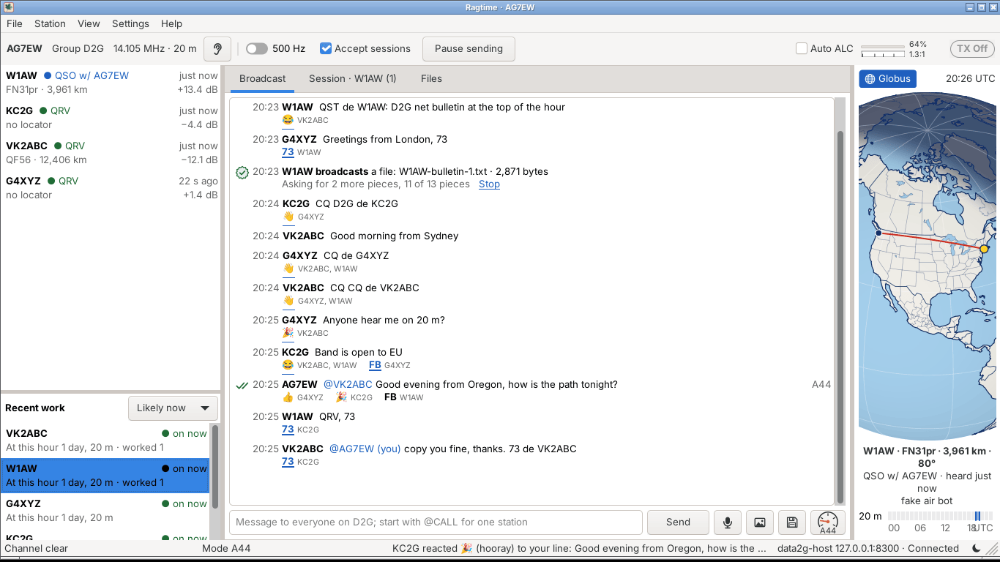
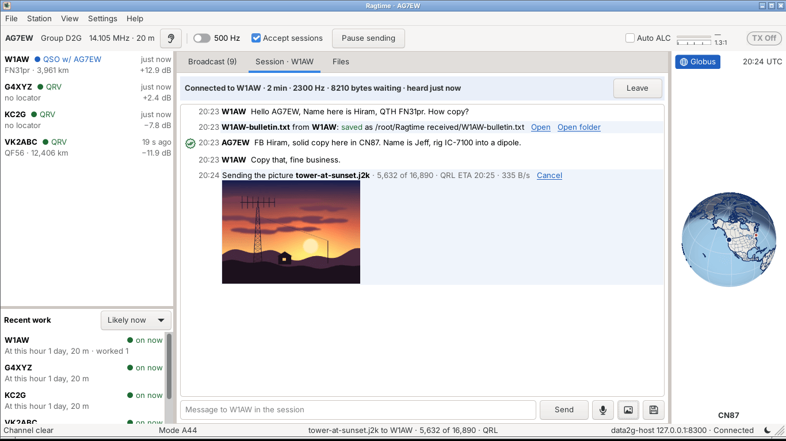
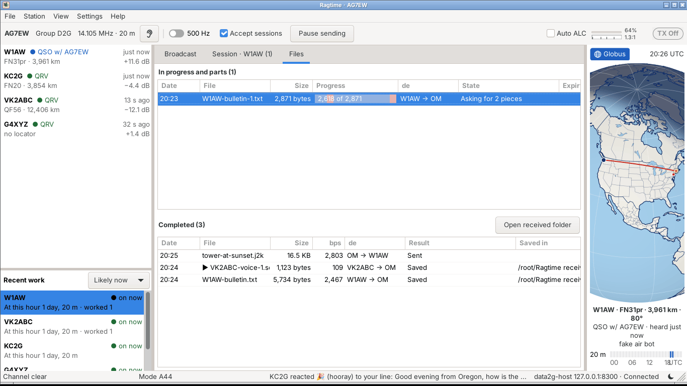
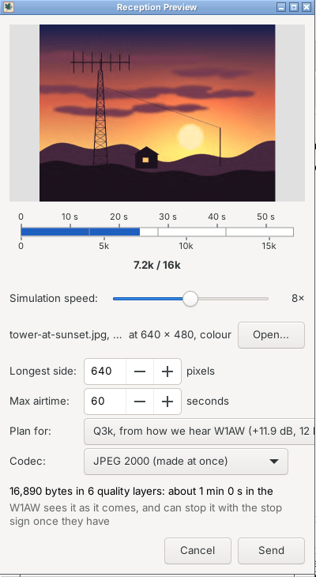
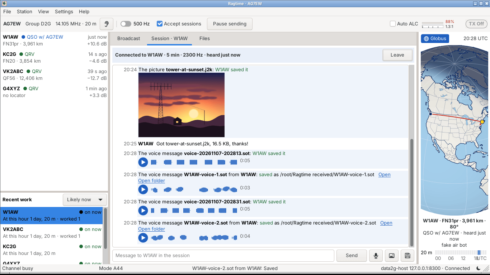
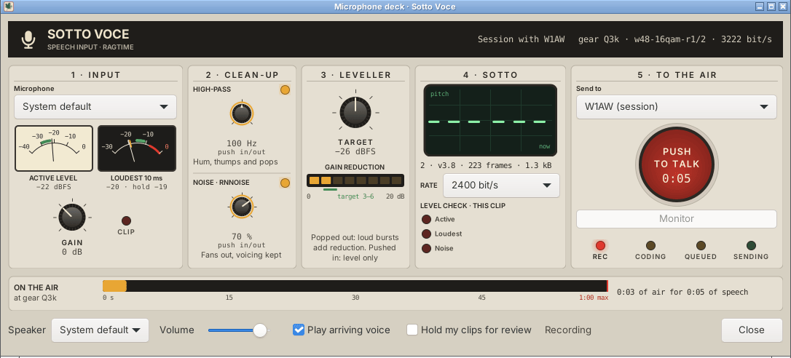
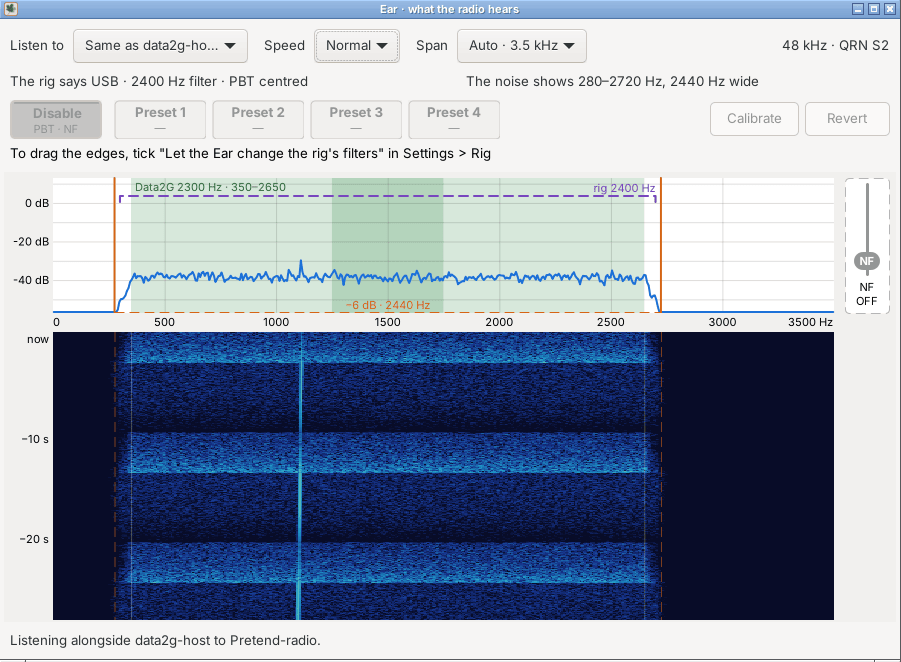
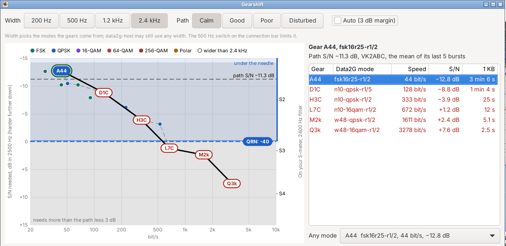

# Ragtime

A plain, friendly chat and file-transfer client for
[Data2G](https://github.com/arodland/Data2G), the HF data modem by Andrew
Rodland, KC2G. Ragtime is a sibling of
[Glissando](https://github.com/baitisj/glissando), Jeff Baitis' (AG7EW)
chirp-mode chat app, and is named for the same musical family and for the
ragchew.

Ragtime helps you keep in touch. Every burst it hears teaches it when,
and on which band, each of your friends gets through, so it can tell you
who is likely around now, and the best time of day to check in to the
D2G net to find them.

Status: 0.2.0-beta. Ragtime connects to data2g-host,
chats on the D2G broadcast group. Current features include:
- "Globus," which plots your friend's maidenhead coordinates
   on a globe,
- "Gearshift," a graphical representation of different Data2G modes,
  which aids in the selection of the optimal rate for chatting with
  the group. NOTE: THIS REQUIRES DATA2G's mode_thresholds.json
  -- see below for more details.
- Peer-to-peer sessions, which feature automatic rate negotiation and
  file transfer.
- Group file transfer which includes repair rounds.
- "Recent work," under the station list: the stations you hear and
  work, the ones likely around at this hour first, from two weeks of
  the path log (who was heard when, and on which band).
- Voice messages, coded with [sotto](https://github.com/baitisj/sotto),
  Jeff's vocoder: 300 bytes for each second of speech at 2,400 bit/s,
  150 at 1,200, 75 at 600 or 50 at 400, every rate with sotto's
  4-8 kHz hiss band, sent as a file the way pictures go, and in a ragchew played
  while it is still arriving. The deck's Rate picks. Voice over Data2G
  is data, so it goes wherever Data2G runs; at 2,400 it is a gear
  5-and-up feature, and the slower rates take it lower.

## Screenshots

These were taken on the bench that comes with the build
(`ragtime_fake_air`, below): fake data2g-hosts and a few chatty bot
stations, with no radio. The picture of the tower is drawn for the
occasion.

**The D2G net.** The Broadcast tab, with the stations heard on the
left, Recent work under them, and Globus on the right drawing the path
to the station picked in Recent work. Reactions sit under the lines,
and an `@` message shows its acknowledgement. Further up, a file
broadcast by W1AW is being repaired: two pieces were lost, and Ragtime
is asking for them.

**A ragchew.** A session with W1AW: a file offered and saved, and a
picture going out, shown as it is sent.

**Files.** Everything coming and going, with the repair under way: the
red gaps in the bar are the pieces still missing.

**Pictures and voice.** A picture is shrunk and coded as progressive
JPEG 2000 (or Cool-chic) to fit the airtime you allow. The preview
plays it as the far end will see it arrive. Voice messages come back
as cards with a play button and the clip's pitch strip.

<table>
<tr>
<td width="32%"></td>
<td></td>
</tr>
</table>

**The microphone deck.** Speech goes through a high-pass, RNNoise,
a leveller and sotto, with meters all the way. Hold Push to talk (or
the space bar), let go, and the clip goes to the net or to the station
you are ragchewing with. The bar along the bottom is the airtime it
will take at the current gear.

**The Ear.** A waterfall and spectrum of what the radio hears,
recorded alongside data2g-host. It draws Data2G's passband, the rig's
filter as the rig reports it, and the edges the band's noise really
shows. With its box ticked in Settings > Rig, you can drag the
filter's edges, or the notch out of its bay, right on the scope.

**The gearshift.** Data2G's modes as gears, plotted by speed and the
S/N each needs. The black dashed line is the path: the weakest station
heard in the last 15 minutes, since a broadcast must reach them all.
Gears in red need more than that, less a 3 dB margin. The blue line is
the band's noise from the rig's S-meter, with an axis on the right
saying what each gear's station reads on your S-meter; the blue
shading is "under the needle", stations you can copy but the S-meter
can't show.

## Downloads

Releases carry a Linux AppImage (x86_64, glibc 2.39 or newer, as on
Ubuntu 24.04) and a portable Windows zip (64-bit). Ragtime needs a
[data2g-host](https://github.com/arodland/Data2G) running on your
computer or your network; it never bundles or starts one. Give its
address and ports in Settings > Station.

The gearshift reads Data2G's `data2g/codes_data/mode_thresholds.json`
from your Data2G clone: from `$DATA2G_HOME`, or a `Data2G` or `data2g`
folder in your home folder or its `src`, `git`, `code`, `projects`,
`Projects`, `repos` or `dev` folder. Otherwise load the file with **Load
thresholds...** in the gearshift. See [docs/GEARBOX.md](docs/GEARBOX.md).

## Building

On Ubuntu 24.04:

    sudo apt-get install build-essential cmake pkg-config libwxgtk3.2-dev libgtk-3-dev libhamlib-dev libpipewire-0.3-dev \
        libopenjp2-7-dev libwebp-dev libheif-dev libheif-plugin-libde265 git
    cmake -S . -B build -DCMAKE_BUILD_TYPE=Release
    cmake --build build -j$(nproc)
    ctest --test-dir build --output-on-failure
    ./build/app/ragtime

### Libraries

These are all the libraries the build looks for. The package names are
Ubuntu 24.04's (Debian uses the same `-dev` names); other distributions
have them under their own names.

| Library | Ubuntu package | For | Without it |
| --- | --- | --- | --- |
| A C++17 compiler (GCC 13, 14 and 16 tested), CMake 3.16 or newer, pkg-config | `build-essential cmake pkg-config` | The build | Required |
| wxWidgets 3.2 (GTK 3) | `libwxgtk3.2-dev` | The window | `-DRAGTIME_APP=OFF` builds only the core, the rig library and their tests |
| GTK 3 | `libgtk-3-dev` | The ham phrase highlight in the entry lines | Required for the app |
| Hamlib | `libhamlib-dev` | Settings > Rig, opening the rig with Hamlib | `-DRAGTIME_HAMLIB=OFF` |
| PipeWire 0.3 headers | `libpipewire-0.3-dev` | The Ear's listening | `-DRAGTIME_PIPEWIRE=OFF` |
| OpenJPEG 2.5 and libwebp | `libopenjp2-7-dev libwebp-dev` | Inline pictures: JPEG 2000 both ways, WebP read | `-DRAGTIME_PICTURES=OFF` |
| libheif, with its libde265 plugin | `libheif-dev libheif-plugin-libde265` | Pictures read from HEIF (phones' `.heic`) | `-DRAGTIME_HEIF=OFF` |
| git | `git` | Building libsotto for voice when configuring (below) | `-DRAGTIME_BUILD_SOTTO=OFF`, or a warning and no voice |

Warnings are errors by default. If a compiler we haven't tried stops
the build on a warning, `-DRAGTIME_WERROR=OFF` lets it finish, and we'd
like to hear about it.

Ragtime reads JPEG, PNG and TIFF through wxWidgets, never with those
libraries itself. They come in with wxWidgets, which is built against them: the
linker wants whichever `libjpeg`, `libpng`, `libtiff` and `libwebp`
your wxWidgets was built with, and any version does as long as it is
that one. On Ubuntu 24.04, `libwxgtk3.2-dev` pulls them in, libjpeg as
libjpeg-turbo 2.1.5 (`libjpeg-turbo8`, giving `libjpeg.so.8`), so there
is nothing more to install.

At run time the app needs the same libraries without `-dev`
(`libwxgtk3.2-1t64`, `libhamlib4t64`, `libopenjp2-7`, `libwebp7`,
`libheif1`), and HEIF needs `libheif-plugin-libde265` (the AppImage
carries it). The Ear loads
`libpipewire-0.3.so.0` (`libpipewire-0.3-0t64`) only when it opens, and
needs PipeWire to be the sound server. On Windows it listens through
WASAPI, which needs nothing installed.

### Voice messages: libsotto

Voice messages are coded with [sotto](https://github.com/baitisj/sotto).
Ragtime loads it at run time as a shared library and never links it, so
it builds without it: with no libsotto the voice cards still draw, and
Play and the deck say libsotto is missing. Ragtime needs sotto v3.8,
at the commit pinned in `packaging/sotto.sh`: it codes 16 kHz speech
with a 4-8 kHz hiss band (codec 2), and plays clips from the earlier
v3.6 (codec 1) too. An older libsotto (v3.6 or v3.7) is passed over.
From the pinned commit it also codes sotto 1200, 600 and 400 with the
hiss band (codecs 3, 4 and 5), from and to 16 kHz.

**The build makes it for you.** On Linux, configuring Ragtime (`cmake -S
. -B build`) builds libsotto when none is found, in about ten seconds,
into `build/build-sotto/out/`, where the program finds it. It runs once,
and again only when the pinned commit changes. It needs `git`, `cmake`,
`make` and a C compiler. If it can't build libsotto
(offline, say), configuring goes on with a warning, and the next
configure tries again. `-DRAGTIME_BUILD_SOTTO=OFF` turns it off.

To build it by hand instead:

    packaging/build-sotto.sh      # build-sotto/out/libsotto.so.0 and libcodec2.so.1.2

Either way, it clones sotto, builds the Codec 2 fork that sotto carries
(Ubuntu's own `libcodec2` won't do), and leaves `libsotto.so.0` in a
`build-sotto/out/` folder. Ragtime looks for libsotto in these places,
in order:

1. `$RAGTIME_SOTTO`, the full path to the file, for a libsotto kept
   anywhere else.
2. Beside the `ragtime` program.
3. `../lib/` from the program (where the AppImage keeps it).
4. `build-sotto/out/` in any of the four folders above the program:
   the build folder's (from configuring) or the checkout's (from
   `build-sotto.sh`).
5. The system's library path (`libsotto.so.0`; `sotto.dll` on Windows).

It takes the first that loads and says `sotto v3.8`; one from an older
pin is passed over.

libsotto finds its `libcodec2` in its `build-sotto` folder, so leave
that folder where it is. The microphone deck shows which sotto loaded (hover
over its codec line to see the path), or why none did.

The AppImage carries libsotto and its Codec 2 (`make-appimage.sh` runs
`build-sotto.sh`). There is no Windows `sotto.dll` yet, so the Windows
zip can't record or play voice. `make-zip.sh` adds one when
`RAGTIME_SOTTO_DLL_DIR` names a folder that holds it.

The helper scripts need a few more tools: `tools/ear/pretend_radio.sh`
wants `pipewire-pulse`, `pulseaudio-utils` (`pactl`),
`pipewire-bin` (`pw-play`, `pw-cat`) and `python3-numpy`;
`tools/gcc16/check.py` wants Docker; and `tools/icon/make_icons.sh`
wants `librsvg2-bin` and `imagemagick`.

### Packages

    packaging/linux/make-appimage.sh      # dist/Ragtime-<version>-...-x86_64.AppImage
    packaging/windows/make-zip.sh         # dist/Ragtime-<version>-...-windows-x86_64.zip

The Windows build cross-compiles on Ubuntu 24.04 with
`g++-mingw-w64-x86-64-posix` and builds its own static wxWidgets and
Hamlib (which needs `autoconf automake libtool`); with
Wine installed, `ctest --test-dir build-win` runs the unit tests as
Windows programs.

### Trying it without Data2G

The build includes a bench of fake data2g-hosts with a few chatty
stations of its own. Nothing goes on the radio.

    ./build/tests/ragtime_fake_air &
    ./build/app/ragtime --config /tmp/ragtime-a.conf

Set any callsign and locator in Settings > Station; the address
127.0.0.1 and ports 8100 and 8300 are the defaults. A second Ragtime
with its own `--config` file and ports 8110 and 8310 talks to the first.

A tester's report (Help > Save a report) plays back the same way:
`ragtime_fake_air --replay flight/` gives a Ragtime the host's side of
the recording, at the spacing the tester saw (docs/FLIGHT_RECORDER.md).

## Frequencies

Where to try Ragtime under Part 97: places in the US HF data segments
clear of the busy weak-signal spots. Nobody owns these, and nothing here
is a schedule. Listen first, and move if someone is there.

In USB a Data2G burst sits about 0.3 to 2.7 kHz above the dial (less for
narrow modes). So keep the dial at least 0.3 kHz above the low edge of a
range and 2.7 kHz below its high edge. Figures are the signal, in MHz.

| Band | Try | Avoid nearby |
| --- | --- | --- |
| 80 m | 3.581–3.585 (room for one wide burst) | WSPR 3.5700–3.5702; FT8 3.573–3.576; FT4 3.575–3.578; JS8Call 3.578–3.581; automatic stations 3.585–3.600 |
| 40 m | 7.081–7.099, 7.105–7.122 | WSPR 7.0400–7.0402; FT4 7.0475–7.0505; FT8 7.074–7.077; JS8Call 7.078–7.081; automatic stations 7.100–7.105 |
| 30 m | 10.143–10.149 | JS8Call 10.130–10.133; FT8 10.136–10.139; FT4 10.140–10.143; WSPR 10.1400–10.1402 |
| 20 m | 14.083–14.095, 14.112–14.147 | FT8 14.074–14.077; JS8Call 14.078–14.081; FT4 14.080–14.083; WSPR 14.0970–14.0972; NCDXF beacons 14.100; automatic stations 14.095–14.112 |
| 17 m | 18.085–18.097 | FT8 18.100–18.103; FT4 and JS8Call 18.104–18.107; WSPR 18.1060–18.1062; automatic stations 18.105–18.110; NCDXF beacons 18.110 |
| 15 m | 21.081–21.089, 21.100–21.139, 21.152–21.199 | FT8 21.074–21.077; JS8Call 21.078–21.081; automatic stations 21.090–21.100; WSPR 21.0960–21.0962; FT4 21.140–21.143; NCDXF beacons 21.150 |
| 12 m | 24.895–24.911 | FT8 24.915–24.918; FT4 24.919–24.922; JS8Call 24.922–24.925; automatic stations 24.925–24.930, with WSPR 24.9260–24.9262; NCDXF beacons 24.930 |
| 10 m | 28.081–28.119 | FT8 28.074–28.077; JS8Call 28.078–28.081; automatic stations 28.120–28.189, with WSPR 28.1260–28.1262 and FT4 28.180–28.183; beacons 28.190–28.300 |

60 m is channels and one small segment (47 CFR 97.303(h)). Data goes
on a channel only with the carrier 1.5 kHz below its centre: the dial at
exactly 5.3305, 5.3465, 5.3715 or 5.4035 MHz in USB, at up to 100 W
ERP. The band segment 5.3515–5.3665 MHz takes data anywhere, at up to
9.15 W ERP (about 9 W into a dipole); keep the dial at 5.3545–5.3635 MHz.
FT8 is at 5.357 dial. With "Receive only outside the US data segments"
ticked, Ragtime holds sending anywhere else on 60 m.

How these were picked (2026-10-26):

- **What's busy.** PSK Reporter's mode counts for the two hours before
  21:40 UTC: FT8 3.2 million reports, FT4 148,000, WSPR 128,000, CW
  14,000, JS8Call 8,900, VarAC 4,500, RTTY 95, PSK31 51. So the table
  steers around FT8, FT4, WSPR and JS8Call, and treats the old PSK31 and
  Olivia spots as free. VarAC's calling spots (3.595, 7.105, 10.133,
  14.105, 18.106, 21.105, 24.927, 28.105 MHz dial) are left open on
  purpose: Data2G is VarAC's spiritual successor, and its users are the
  people most likely to try Ragtime. RTTY contesters don't report to PSK
  Reporter, and they fill the RTTY areas on contest weekends.
- **Where.** The "avoid" figures are the usual WSJT-X and JS8Call
  dial frequencies plus the audio those modes use. The ARRL band
  plan's RTTY and data areas come first; the 17 m and 12 m ranges sit
  just below them. The ranges also clear Glissando's presets (3.570,
  7.067, 14.067, 18.097, 21.067, 24.911, 28.067 MHz dial).
- **Other countries' band plans.** Part 97 allows 2.8 kHz data
  throughout these segments, but IARU band plans ask for less in places,
  and DX stations follow them. Region 1 (Europe, Africa) keeps all of
  30 m to 500 Hz. Region 2 (the Americas) allows 2.7 kHz at 10.140–10.150,
  and asks for 500 Hz at 3.580–3.600, 14.070–14.099, 21.070–21.090,
  21.120–21.149 and 28.070–28.190 MHz. Use a narrow mode there when
  working DX. In other Region 2 countries 7.060–7.100 and 14.112 MHz up
  are SSB, so expect phone there.
- **Licences.** Data on these bands needs a General licence or higher,
  except on 10 m, where Technicians may send data up to 28.300 MHz.
- Ragtime turns receive only when the dial is outside a US data
  segment, or less than 3 kHz inside its edge, and says so in the
  connection bar.
- Unattended stations (automatic control) must stay in the narrower
  segments of 97.221(b); see "Frequencies and band plans" in
  [docs/PLAN.md](docs/PLAN.md#frequencies-and-band-plans).

Sources: [ARRL band plan](https://www.arrl.org/band-plan),
[IARU Region 2 band plan](https://www.iaru.org/wp-content/uploads/2020/10/IARU-Region-2-Band-plan.pdf),
[PSK Reporter statistics](https://pskreporter.info/cgi-bin/pskstats.pl).

## The idea

- **Welcome to the D2G net.** D2G is a net that never closes. You check
  in, net control asks for traffic, and the traffic gets passed. Every
  burst teaches the net who hears whom.
- **Sometimes we ragchew.** When operators want to talk, they enter a
  point to point ragchew on purpose and leave it on purpose.

Ragtime is a front end for a separately running `data2g-host`, reached
over TCP. It never starts the modem and never plays to the radio's
sound card; its Ear only listens in, through PipeWire on Linux or
WASAPI on Windows, to what data2g-host records, and voice uses your own
microphone and speaker, never the radio's card (Settings > Voice).
It reads the radio's dial from rigctld, or opens the rig itself with
Hamlib (Settings > Rig), and can key it when data2g-host does, for rigs
whose drivers can't be opened twice (off by default). Through Hamlib or
rigctld, the Ear can also set the rig's receive filter: drag the edges
on the waterfall, or the notch out of its bay, and the change goes back
after 15 s unless you keep it (off by default).
Messages are signed, never encrypted, as Part 97 requires.

## Plan

| Document | What |
| --- | --- |
| [docs/PLAN.md](docs/PLAN.md) | The full design: the net, ragchews, broadcast mode, files, signing, store and forward, frequencies, decisions and open questions |
| [docs/STAGE1.md](docs/STAGE1.md) | Stage 1, parity with Glissando's Data2G mode, split into work packages |
| [docs/HOW_SEALS_WORK.md](docs/HOW_SEALS_WORK.md) | Seals in plain words, with pictures: what is inside one, how repairs work, and what a late joiner asks for |
| [docs/GEARBOX.md](docs/GEARBOX.md) | The gearshift: how a Data2G mode is picked from the Submode Map |
| [docs/MOCKUPS.md](docs/MOCKUPS.md) | The screens, colours, Globus and seal icons |
| [docs/PICTURES_AND_VOICE.md](docs/PICTURES_AND_VOICE.md) | Draft spec for analogue SSTVAE pictures in chat, with the US band segments and Part 97 notes (not built; waits on Data2G). Its RADE voice clips are retired in favour of sotto voice messages |
| [CLAUDE.md](CLAUDE.md) | Working notes and ground rules for contributors |

## Licence

MIT. See [LICENSE](LICENSE).

## Credits

Voice messages are coded with [sotto](https://github.com/baitisj/sotto),
by Jeff Baitis (AG7EW). Ragtime loads it at run time as a shared library
(`libsotto.so`, `sotto.dll`), because sotto's analysis and synthesis come
from David Rowe's [Codec 2](https://github.com/drowe67/codec2), which is
LGPL-2.1; the rest of sotto is MIT. sotto's codebook was trained on
Codec 2's own test recordings and on these datasets, both under
[CC BY 4.0](https://creativecommons.org/licenses/by/4.0/):

- [Speech Commands](https://arxiv.org/abs/1804.03209), Pete Warden,
  Google, 2018.
- [LibriSpeech](https://www.openslr.org/12) (dev-clean), Vassil Panayotov,
  Guoguo Chen, Daniel Povey and Sanjeev Khudanpur, 2015, from LibriVox
  recordings.
