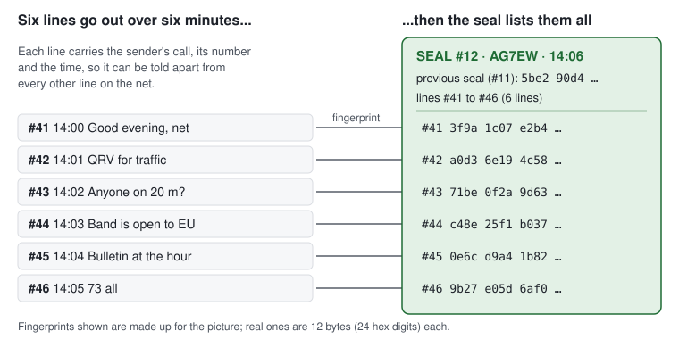
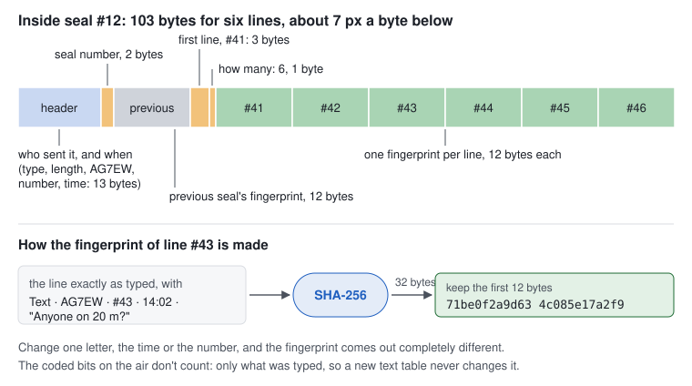
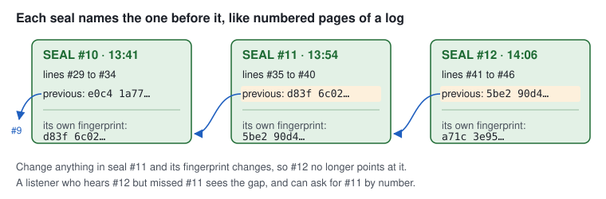
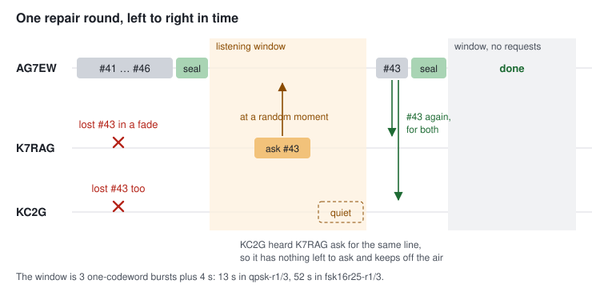
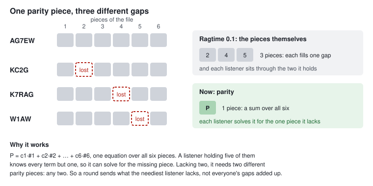
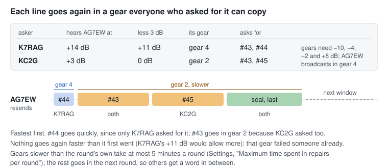
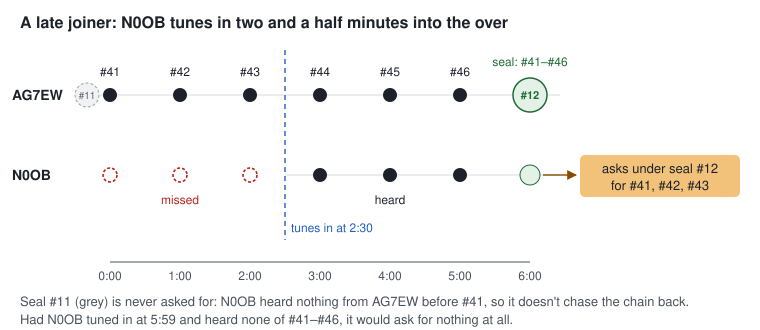

# How seals work

A plain-words primer on Ragtime's seals: what they are, when they go,
what is inside one, how they get lost lines sent again, and what a
station that tunes in late does with them. The exact rules, byte for
byte, are in [PROTOCOL.md](PROTOCOL.md) ("Seal", "RepairRequest" and
"Seals and repair"), and the reasoning behind them is in
[PLAN.md](PLAN.md) ("Seals, receipts and repairs"). The code is
`core/src/broadcast/Seals.*`.

## The problem a seal solves

On the D2G net, one station talks and many listen. HF fades come and
go, so any listener may lose any burst, and nobody can tell what was lost
just by listening to what arrived.

In a one-to-one ragchew (a session) Data2G handles this itself: the far
end acknowledges what it got, and the rest goes again. That doesn't work
on a net. Twenty listeners can't all acknowledge every line, because the
acknowledgements would take more airtime than the chat. And the sender
can't wait for all of them, because it doesn't know who is listening.

A seal turns the problem round. **The sender doesn't ask who got what.
Every so often it says what it sent**, and each listener checks that
against what it holds and speaks up only if something is missing.

## A seal is a packing slip

Think of a parcel with a packing slip inside: "3 shirts, 2 pairs of
socks, 1 hat". You don't phone the shop to say what arrived. You check
the box against the slip, and call only if the hat is missing.

A seal is that slip for a run of broadcasts. After a few lines (or a
file), the sender broadcasts one more record, the seal, which lists
everything since its last seal: "lines #41 to #46, and here is a
fingerprint of each".

Every line on the net carries the sender's callsign, a number that
counts up (#41, #42, ...) and the time. So "AG7EW #43" names one line,
and nothing else on the net has that name.

## When a seal goes

- **Files are always sealed.** A broadcast file's announce (its name,
  size and whole-file fingerprint) is listed in a seal, and repairs of
  its pieces hang off that seal.
- **Chat is sealed only if you ask for it**, with Settings, "Seal my
  broadcast messages". It is off by default. A seal is a transmission of
  its own. On a poor path that is not cheap: Andrew measured 350 bytes
  at 30 to 60 s at Data2G's lowest working rungs, and a seal over six
  lines is about 100 bytes. Plain chat must never wait on a seal, so
  unsealed chat simply goes, and isn't repaired.
- **The timing.** A station seals what it has sent and not yet sealed
  when it has nothing more of its own to send and:
  - 60 s have gone by since its last line (the end of an over), or
  - a file's first pass has just ended, so repairs can start at once,
  - and in any case once the oldest unsealed line is 10 minutes old.

  So a seal covers one over. It covers six minutes only when the
  station has chatted steadily for six minutes, never pausing for 60 s.
- **Big overs.** One seal fits in one broadcast frame of 255 bytes,
  which holds about 18 fingerprints. A longer run goes as several seals,
  packed into the same burst.

## What is inside a seal

Seal #12, over six lines, is 103 bytes:

| Part | Bytes | What it says |
| --- | --- | --- |
| Header | 13 | That it is a seal, from AG7EW, made at 14:06, after line #46 |
| Seal number | 2 | This is seal #12. They count up from 1 |
| Previous | 12 | The fingerprint of seal #11 (zeros on a station's first seal) |
| First line | 3 | The list starts at line #41 |
| Count | 1 | Six lines are listed |
| Fingerprints | 12 each | One per line: #41, #42, ... #46 |

**A fingerprint** (a "digest" in the protocol's terms) is what you get
by feeding the line, exactly as typed, through SHA-256 and keeping the
first 12 bytes. It covers who sent it, its number, its time and its text.
Change one letter, the time or the number, and the fingerprint comes out
completely different. Two different lines sharing a fingerprint by chance
is about as likely as guessing a number between 1 and 79 thousand
trillion trillion (2⁹⁶) on the first try.

A few things the fingerprint deliberately ignores:

- **How the text was coded on the air.** Ragtime packs text with
  Glissando's ham-word Huffman table, but the fingerprint is taken over
  the plain UTF-8 that was typed. A new text table never changes a
  fingerprint.
- **File pieces.** A file is listed once, by its announce, whose
  fingerprint covers the file's size, piece size and the SHA-256 of the
  whole file. Data2G's own coding catches a damaged piece, and the
  whole-file check proves the finished file.
- **Lines that never went.** A line whose burst the host couldn't send
  is listed with a zero fingerprint, so nobody asks for it.

## Seals are chained

Each seal carries the fingerprint of the seal before it, so the seals
form one unbroken log, like numbered pages.

The chain does two jobs:

- **Gaps show.** A listener who hears seal #12 but never heard #11, and
  was listening before, can tell it missed one, and asks for seal #11 by
  number.
- **Nothing can be slipped in later.** Altering seal #11 changes its
  fingerprint, and #12 no longer points at it. Once seals are signed
  (Stage 2), one signature on the newest seal vouches for the whole
  chain behind it.

## Repairs: asking for what you missed

When a seal arrives, each listener compares the list with what it holds.
For every listed line it either has (with the same fingerprint), lacks,
or holds a copy of that doesn't match. For a file it is receiving, it
works out how many pieces it lacks.

1. **The sender listens.** After its seal, the sender holds a
   *listening window*: three one-codeword bursts' worth of airtime in its
   mode, plus 4 s. That is 13 s in `qpsk-r1/3` and 52 s in the slow
   `fsk16r25-r1/3`.
2. **A listener that lacks something waits a random moment** within the
   window, then sends one short *repair request* naming the seal and,
   one bit per line, what it lacks, and for each file how many repair
   pieces it wants: a count, not a list. It asks for more than it lacks,
   allowing for what it expects to lose (below). The request also says
   how well the listener hears the sender (below too).
3. **Others keep quiet when they can.** A listener that hears someone
   else ask for at least as much as it lacks keeps quiet about it, as
   long as that station hears the sender no better than it does. If
   nothing is left, it never transmits. On a busy net one request
   usually speaks for many.
4. **The sender answers once, with parity.** At the window's end it
   sends as many repair pieces as the neediest listener asked for, each
   in a gear the stations that asked for it can copy, then the seal
   again. That opens another window.
5. **A quiet window ends it.** A seal over a file goes up to twice
   more after a quiet window, in case the seal itself or a request was
   lost.

**When every seal is lost.** A request names a seal, so a station that
lost every copy of one (the first, the one ending each round, and a
file's two repeats) wouldn't know what to ask under. At 60% loss that
was about one station in ten. So a station that heard any of a file,
its announce or a single piece, but no seal over it 3 minutes after the
last of it came, asks for "the seal over this file" by the file's
number, under seal 0, and again every 3 minutes, up to 10 times. The
sender sends that seal again, and the repairs go on from there. And a
station that still lacks something under a seal, with nothing from the
sender for 3 minutes since its last request, asks again: the seal that
ended the round was lost.

A listener that has asked five times under a seal and got nothing stops
asking, and the file shows as incomplete. *Ask again* on the file starts
afresh, as long as the seal is under 2 hours old.

### Parity: one repair piece fills many gaps

Ragtime 0.1 repaired the plain way: every piece anyone lacked went
again. On Jeff's nets that was the wrong shape. With stations spread
across the US on one band, someone is always the "loser", dropping half
or more of every burst, and the gaps of five stations are five
different sets. Sending them all again sends most pieces to stations
that already hold them, and the loser loses half of the repairs too, so
it asks again, and again.

A **parity piece** is a weighted sum of all the file's pieces. Think of
the file's pieces as unknowns, #1 to #6. A parity piece is one equation
in them:

  P = c1·#1 + c2·#2 + c3·#3 + c4·#4 + c5·#5 + c6·#6

A station holding five pieces knows five of the six terms, so one
equation gives it the sixth. A station missing two needs two equations,
but *any* two will do, provided the weights are chosen well. Ragtime's
weights come from a Cauchy matrix, c = 1 / (x + y), where y names the
piece and x names the parity piece. With them, any set of equations is
solvable: every square block of a Cauchy matrix can be inverted.

That is the whole trick. Every parity piece is useful to every station
that lacks anything, whichever pieces it lacks. So the sender doesn't
add up the gaps. It sends what the neediest station asked for, and
every other station takes what it needs from the same pieces.

The arithmetic isn't ordinary arithmetic, which would overflow and
round. It is done in GF(2^16), the "Galois field" of 16-bit numbers. In
it, adding is XOR, multiplying is done with a table of logarithms, and
every number but 0 can be divided by. So a piece is read as a row of
16-bit numbers, and each number is summed separately. This is the
Reed-Solomon code of CDs and QR codes, in the Cauchy form used by
storage systems for lost disks. We use it for *erasures*: Data2G's own
coding already tells a station which pieces it lost, so it never has to
find them, only fill them.

**Asking for enough.** A station that lacks n pieces and loses a share p
of what it hears asks for

  want = (n + √(n·p/(1−p))) / (1−p)

The n/(1−p) part is what it expects to need: lacking 10 and losing half,
it needs about 20 sent to catch 10. The square-root part is about one
standard deviation more, for bad luck. Together they fill every gap in
one round about nine times in ten. A station judges p from the first
pass (the share of the file it lost since the first piece it heard),
then from each round (the share of the parity it asked for that didn't
come). Below 0.75 that sum stays modest; at 0.75 it is held, so a
station that hears nothing doesn't ask for the moon.

**Chat lines** are repaired the same way, with ItemParity records over
the lines a station asked for: each line's record is a symbol, padded
to the longest. When every station that asked lacks only a few of
several lines, a few ItemParity records cost less than the lines.
When the wants add up to the lines or more, the lines themselves go
first, with parity after them for the losses. A line rebuilt from
parity must match the seal's fingerprint, and then shows as if heard.

**What it bought,** in Ragtime's own simulator: a 6 KB file (29
pieces) to five stations, losing what the table says of every record,
ten runs of each. "Finished" is within three hours; the minutes are
for the runs that finished.

| Path | 0.1: rounds, finished, minutes | Parity: rounds, finished, minutes |
| --- | --- | --- |
| all five losing 10% | 2.0, 10 of 10, 2 | 1.0, 10 of 10, 1 |
| three at 50%, two at 20% | 9.9, 5 of 10, 4 | 1.9, 9 of 10, 2 |
| two at 60%, three at 10% | 4.8, 0 of 10, – | 1.8, 8 of 10, 2 |

A 30 KB file with two stations at 60% took 9.5 rounds under 0.1 and
finished once in ten runs; with parity, 1.5 rounds and 2 minutes, every
time. The runs that still don't finish are stations that missed every
copy of the seal, so never knew to ask. Since then they ask for the
seal by the file ("When every seal is lost", above), and every run of
every case above finishes, as do two stations at 75% loss (in about 13
minutes). Sealed chat, twelve
lines to three stations each losing half: 5.3 rounds and 17 minutes
under 0.1 (one run in ten unfinished), 1.3 rounds and 2 minutes with
parity. Parity sends somewhat more repair records in that case (33
against 25), the price of asking for enough the first time.

### Which gear a repair goes in

A line was lost because the gear it went in was too fast for someone's
path at that moment. Sending it again in the same gear may just lose it
again. So every repair request carries one more figure: **how well the
listener hears the sender**, its signal-to-noise ratio (S/N) in dB, as
the listener's data2g-host measured it.

- **The figure is the worst of the last 15 minutes,** not the latest.
  A listener can only measure the bursts it decoded; the ones it lost
  went by in fades it never measured. The worst decoded burst is the
  nearest it can get to the bottom of the fade.
- **It costs nothing on the air.** It rides in seven spare bits of a
  byte the request already had, in half-dB steps from −24 to +39 dB.
- **The sender picks the gear,** with the same sum the gearshift's Auto
  uses: the fastest gear on its own ladder that needs no more than the
  listener's S/N less 3 dB. A measurement travels better than a mode
  name, because the two stations' ladders may differ.
- **Each line gets the gear of the weakest station that asked for it,**
  and never a faster gear than it first went in: that gear failed
  someone already. Lines only strong stations asked for go fast; only
  what a weak station lacks goes slowly.

The sender works gear by gear, fastest first, so the stations that hear
it best are served soonest, and sends the seal last in the slowest gear
it used, so every station that asked can copy it.

This is why keeping quiet now has a condition. If KC2G (+3 dB) heard
K7RAG (+14 dB) ask for #43 and stayed quiet, #43 would come back in
K7RAG's fast gear, and KC2G would lose it again. So a listener keeps
quiet only behind a station whose gear is no faster than its own.

**Slow repairs take time.** Six lines and their seal take about 6 s in
`qpsk-r1/3` and about 94 s in `fsk16r25-r1/3`; 4 KB of a file takes
about a minute in the first and 21 minutes in the second. So gears
slower than the round's own may take at most 5 minutes of airtime a
round (Settings, "Maximum time spent in repairs per round", 1 to 60
minutes). What doesn't fit goes in the next round, after the seal, so
other stations get a word in between.

### When the sender says no

Sometimes the sender won't repair what was asked for: its operator
closed the share's repairs or cancelled the file, the seal is past its
2 hours, or Ragtime was restarted and no longer holds it. Rather than
leave listeners asking five times for nothing, it answers once with a
*repair refused*: about 20 bytes naming the seal, the reason, and the
files it covers (or everything under the seal).

It goes at the end of the listening window, once however many stations
asked, in the gear of the weakest of them, and the same refusal goes at
most once in 10 minutes. A listener that hears it stops asking, and the
Files tab says why: "Not repaired: AG7EW cancelled it", with *Ask again*
greyed.

A Ragtime 0.1 station and a newer one still chat, but can't repair each
other: the new request and parity records are types 0.1 doesn't know,
and 0.1's old request is one the new version skips.

### Repaired lines go in their place

A line that comes again after its seal is put where it belongs in the
Broadcast tab, among its sender's lines by their numbers, not at the
bottom: AG7EW's #42 goes above #43, wherever the other stations' lines
fall. The saved history keeps that order after a restart too.

### How long a seal stays answerable

The sender answers requests under a seal while it is *open*, its
"sensitivity window". It is open while it is one of the sender's 3
newest seals, or younger than 4 times the airtime its lines took. It is
never open past 2 hours, unless the operator keeps it open longer (or
closes it now) from the file's menu. A slow mode is listened to for
longer, in proportion to the airtime its lines took.

Listeners keep what they heard of each station, its lines, seals and
file pieces, for the same 2 hours. Broadcast files not yet whole are also
kept on disk, so a restart doesn't lose them.

## A station that tunes in late

Say N0OB tunes in two and a half minutes into a six-minute over, and
then hears the seal that covers all six minutes.

- **Under that seal, N0OB asks for everything it lacks**, including
  the lines from before it tuned in (#41 to #43 here). It heard some of
  the over (#44 to #46), so it counts as following it, and the seal
  says plainly what it missed. If another listener asks for the same
  lines first, N0OB stays quiet and still gets them.
- **It doesn't follow the chain back.** N0OB never heard seal #11 or
  anything before #41, so it doesn't ask for #11 or the lines #11
  covers. A listener asks for a missed seal only if it was already
  hearing that station before the later seal began. A late joiner gets
  the over in progress, not the whole conversation.
- **Tuning in just as the seal arrives asks for nothing.** Had N0OB
  heard none of #41 to #46, only the seal, it would ask for nothing at
  all. It has just arrived, and the over is history.

So a late joiner costs the net at most one resend of the over it walked
in on, and that resend is shared with anyone else who lost the same
lines.

## What the badges mean

With sealed chat on, the Broadcast tab shows each message's seal state
in its left-hand column (right-click a message for the same in words):

| Badge | On your own lines | On theirs |
| --- | --- | --- |
|  Awaiting | sealed chat, its seal not gone yet | |
|  Sealed | the seal went, and nobody has asked for it | their seal lists it, and the fingerprints match |
|  Repairing | a station asked for it, and it goes again | |
|  Held | a station's repair request under the seal didn't ask for it, so that station holds it | |
|  Mismatch | | what you hold doesn't match their seal; a good copy is asked for |

"Held" is the only thing Ragtime calls confirmed. A repair request lists
everything a station lacks under a seal, so whatever it leaves out, that
station holds. Silence is never counted as a receipt: with no request
heard, a seal says only that it went.

## What seals don't do (yet)

- **They aren't signed in version 0.** For now a seal proves only that a
  line arrived intact and complete, not who sent it. Stage 2 adds a
  signature to each seal, and then the Sealed badge will also mean
  "signed by the key this callsign used before".
- **They never hide anything.** Seals are fingerprints, not encryption,
  as Part 97 requires (97.113(a)(4)). Anyone can read every line, and
  anyone can check a seal.
- **They don't repair unsealed chat.** With "Seal my broadcast messages"
  off, a line lost in a fade is simply lost, as on a voice net.
- **They don't repair what nobody knows was sent.** A station that
  heard nothing at all of a file (no piece, no announce) and no seal
  over it doesn't know to ask. One that heard any of it does (see
  "When every seal is lost", above).
