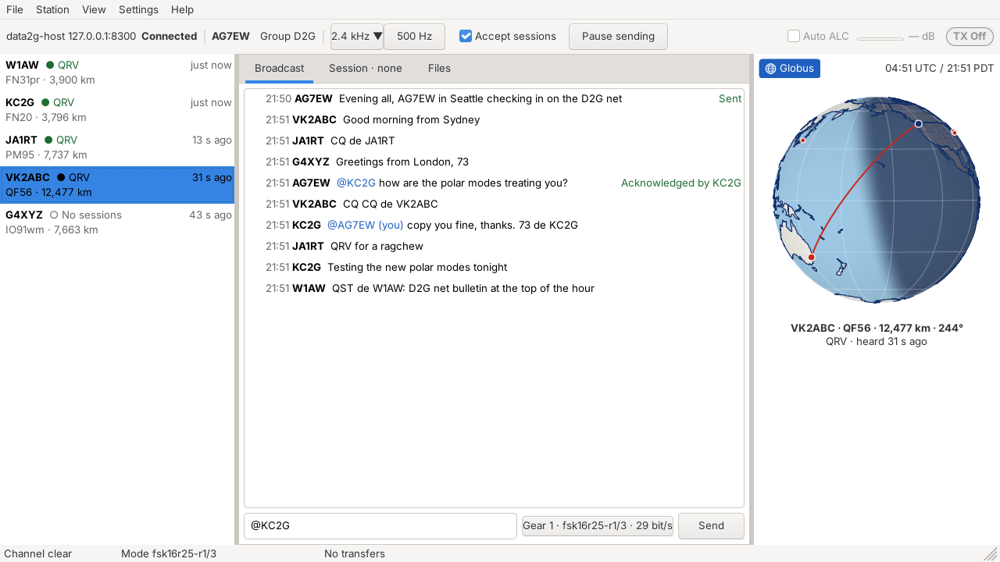
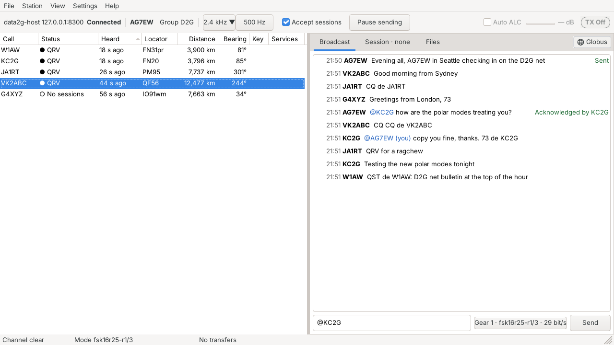
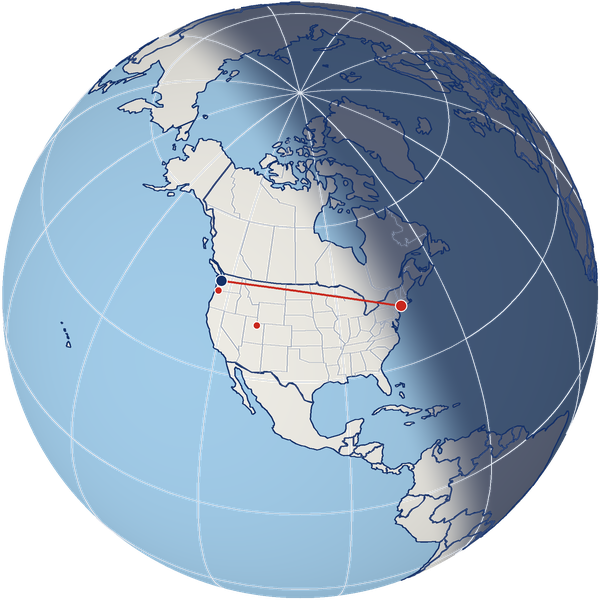
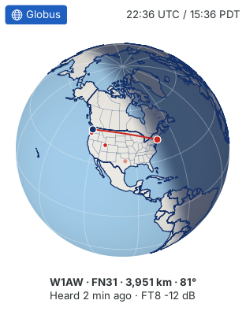

# Mock-ups

The mock-ups are a design canvas Jeff reviewed on 2026-10-21 and
2026-10-22 (https://claude.ai/artifact/4zWdK2uc5du4u4ryRjERNS, private to
Jeff; ask him for a look). This file writes down what a builder needs
from them, so the canvas is never the only copy.

## The boards

| Board | Shows |
| --- | --- |
| Broadcast tab (no session) | The main window: connection bar, station list, Broadcast tab, Globus, status bar. Session tab greyed with "· none" |
| Session tab (in a session) | A session with W1AW: status strip, messages, a file offer card, Leave and Leave now |
| Files tab | Both panes, and the right-click menu on a broadcast share with its repair expiry |
| Globus off, station columns | Globus hidden, messages full width, the station list as a table with the Columns menu open |
| Gearshift on the submode map | The gearshift popup (`GEARBOX.md`): Width and Path chips, the map, the gear list, Auto |
| Seal state icons | The eight seal icons below, at 48, 32 and 16 px, with sample rows |

## Look

- System theme and font; light by default, following the system's dark
  mode. Mock-up tokens: page `#eef0f3`, surface `#ffffff`, text
  `#1d2129`, secondary text `#4a515c`, borders `#d9dce1` and `#b9bec7`,
  accent blue `#1f5fbf` (selected, toggles on, the current gear), focus
  ring `#f0a020`.
- Toggles that are on turn blue: the Globus button, the width button, a
  selected chip.
- Layout at 1280×800: connection bar on top; station list, tabs, and
  Globus side by side (each side pane 280 to 340 px), with draggable
  dividers between them; status bar at the foot.

## Connection bar

Left to right: host address and state, my callsign, group `D2G`, the
width button (`2.4 kHz ▼`) joined to the one-press `500 Hz` button,
Accept sessions, Pause sending, **Auto ALC** (checkbox, a small level
meter, its reading such as `−4 dB`), and the TX light (`TX Off` / `TX`).

## Station list

- Columns: Call, Status, Heard, Locator, Distance, Bearing, Key (seal
  badge), Services. A Columns menu (checkboxes) picks them; SNR is listed
  but disabled, "needs a host report". Sortable by any column.
- With Globus on, the list is narrow: each row is callsign and status,
  with last heard, and under it the locator and distance
  (`FN31 · 3,951 km`).
- Status always pairs a word with its dot (never colour alone).

As built in package E (the bench, `ragtime_fake_air`, at 1280×720),
beside Globus and with Globus off:

## Globus

- Header: the **Globus** toggle (globe icon, blue when on) where the
  heading was, and the lighting time, `22:36 UTC / 15:36 PDT` (local time
  follows the operator's time zone, with daylight time).
- Globus off: the toggle moves to the right end of the tab strip, unlit.
- Theme: oceans `#A8D4F2`, land `#F7F5EE`, coasts and country borders
  `#143068`, state and province lines the same blue at about half
  opacity and thinner, graticule every 30° very faint. The path is a red
  great circle (`#c8281e`), home a navy dot, stations red dots with white
  rims.
- Each line is drawn once (Jeff, 2026-10-22): a coast only where the land
  meets the sea, never along an edge two countries share, which is a
  border; and no state or province line along a country border. The big
  lakes (Natural Earth 1:110m, the Great Lakes among them) are filled in
  the ocean's colour with a coast round them, so Lake Michigan parts
  Wisconsin from Michigan.
- State and province lines (Jeff, 2026-10-22) for the United States,
  Canada, Mexico, Russia, China, India, Brazil, Argentina and Australia,
  its federal territories included: Natural Earth 1:10m, every line the
  1:50m set leaves out among them (British Columbia's with the Northwest
  Territories, for one), smoothed to a quarter of a degree.
- Lighting: the light source sits over the subsolar point. Day side
  Lambert-lit lightly (0.93 + 0.07 cos z); night side is the colour × 0.30
  plus navy `#1C2C56` × 0.55; a smoothstep between sun altitude +3° and
  −12° makes the greyline. A slight limb darkening (0.88 + 0.12 × depth).
- Caption under the globe: `W1AW · FN31 · 3,951 km · 81°`, then the
  station's details.

As built (the pane at 300 px, the same moment, `TZ=America/Los_Angeles`):

## Seal state icons

Each icon is a wax-seal rosette with a glyph inside, so the shape carries
the meaning without colour. The rosette is a closed path through 48
points at radius 9.4 + 0.9 cos 12θ around (12, 12) in a 24-unit box,
stroked 1.5. Glyphs are stroked 2, round caps and joins. A dashed edge
(2.2 on, 1.6 off) means still waiting; a solid fill with a white glyph
means look at this. SVGs are in `images/seals/`.

| Icon | State | Colour | Meaning | Status |
| --- | --- | --- | --- | --- |
|  | Sealed | green `#1e6b34`, tint `#e3f1e6`, check | A seal covering this message has arrived, signed by a key already known for this callsign | Jeff's |
|  | New Identity | blue `#1f5fbf`, tint `#e4ecf8`, star | First time this callsign's key has been seen; kept from now on | Jeff's |
|  | Identity Changed | solid orange `#b54708`, "!" | Same callsign, a different key than last time | Jeff's |
|  | Awaiting Seal | grey `#5b6370`, dashed, clock | The message is here but its seal isn't yet (seals go at most 10 minutes apart) | Jeff's |
|  | Unsigned | caution yellow `#f7c600` fill, dark edge `#6b5200`, slash `#3d2f00` | No signature at all; shown, but never counts as a check-in | Jeff's (2026-10-22: "Use yellow to communicate the idea of caution") |
|  | Receipted | green, double check | On your own message: a listener's receipt says they hold the sealed copy | Proposed |
|  | Repair Asked | amber `#8a4b00`, dashed, turning arrow | A seal lists a message you never heard; a repair request is out | Proposed |
|  | Mismatch | solid red `#b42318`, X | The seal's digest doesn't match the text received; the text is struck through | Proposed |

"Proposed" icons await Jeff's keep or drop. Signing is Stage 2, so Stage 1
leaves room for the badge but doesn't show it.

## Files tab

- Two panes, newest first: "In progress and parts" on top, "Completed"
  below (columns in `STAGE1.md`). From or To says **Broadcast** for a file
  you broadcast.
- Right-click on a broadcast share you are sending: first line greyed,
  "Repairs open until 15:42 (1 h 10 min)", then Keep open 30 min longer,
  Keep open 2 hours longer, Keep open until..., Close repairs now.
