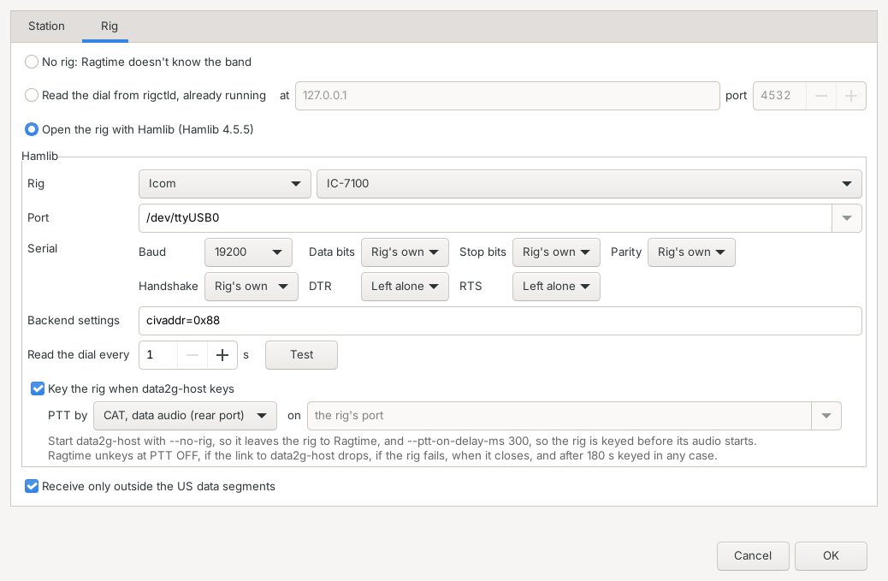
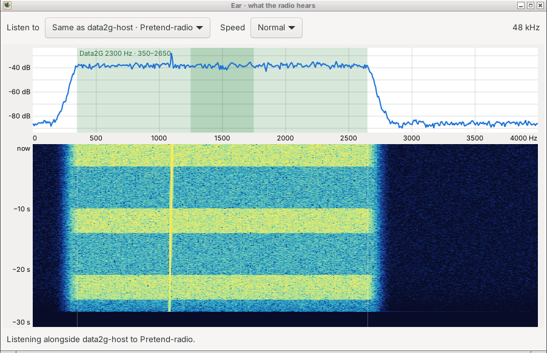
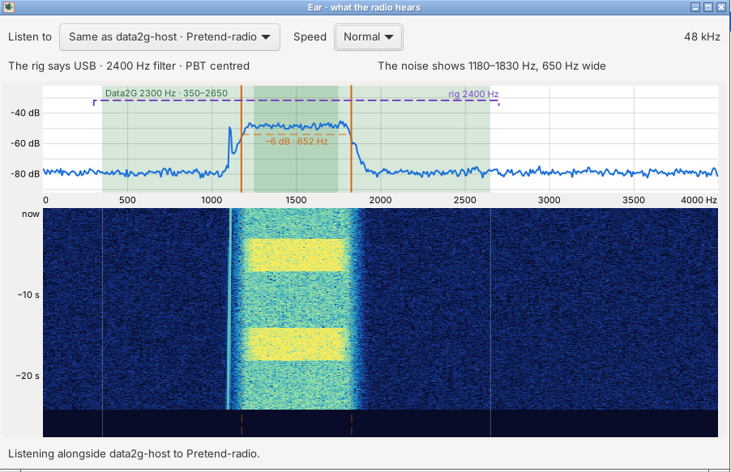
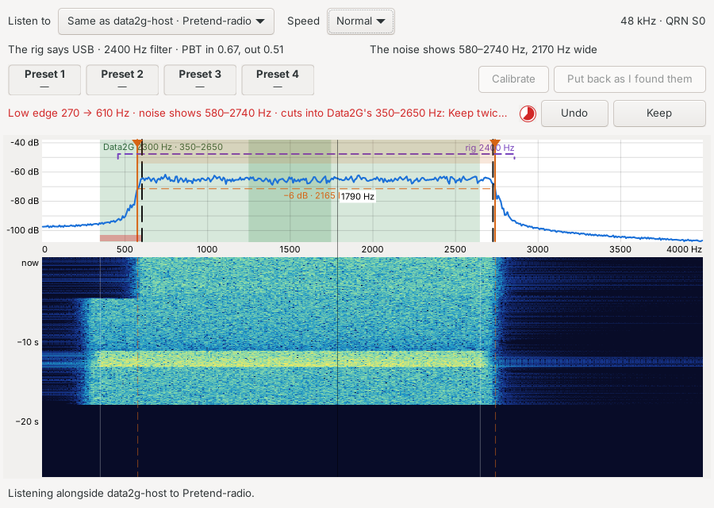

# Stage 1: parity with Glissando, and then some

Jeff said go on 2026-10-22. Stage 1 is build-order steps 1 to 7 in
`PLAN.md`: Ragtime does everything Glissando's Data2G mode does (the
"Functionally equivalent" checklist in `PLAN.md`), in three tabs, plus the
extras Jeff asked for during the mock-ups (the "and then some" below).
When it lands, Glissando can drop its Data2G mode.

Each work package below is sized for one builder and one or a few PRs.
The order shows what depends on what; packages on the same line can run
side by side.

| Package | Needs | Can run beside |
| --- | --- | --- |
| A. Repo skeleton and CI | nothing | |
| B. Protocol v0 and core library | A | C, D |
| C. Globus widget | A | B, D |
| D. Gearshift model and popup | A | B, C |
| E. App shell and Broadcast tab | B (interfaces), C, D | |
| F. Sessions | E | |
| G. Session files and the Files tab | F | H |
| H. Broadcast files with repair | E, B | G |
| I. Packaging and first release | E onward | |

## A. Repo skeleton and CI

Done in the skeleton PR: see "Layout" and "Build and test" in
`CLAUDE.md`. The Windows cross build moved to package I.

- CMake project: `core/` (socket-free library, no wx), `app/` (wx),
  `tests/`, `tools/`, `docs/`. C++17.
- GitHub Actions on Ubuntu 24.04: build core and app, run ctest. A second
  job builds core in the `gcc:16` image with `-Werror`.
- wxWidgets as Glissando builds it (system packages on Linux, the MinGW
  cross build for Windows).

## B. Protocol v0 and the core library

Done in the package B PR: `docs/PROTOCOL.md` is the spec, and
CLAUDE.md's Status lists what is where. For the packages after it:

- **E** opens the host with `link::HostLink` (KISS and command ports),
  builds frames with `protocol::encodeFrame` and numbers broadcasts with
  a `protocol::Numbering` saved across restarts.
- **F** reads the session data port with `protocol::StreamReader`
  (opened by `protocol::streamOpening` and a Hello), with a fresh
  Numbering each session. Reset the reader when a session ends, not when
  `CONNECTED` arrives: the far end's Hello can come first.
- **G** drives `files::SessionFiles` from the session (records, pieces,
  `BUFFER` acknowledgements); keeping part files across restarts is
  still to do.
- **H** has the Seal, RepairRequest, FileAnnounce and FilePiece records
  and `protocol::recordDigest`; the behaviour is its own.

- Write `docs/PROTOCOL.md` v0 before the code: the records from PLAN.md's
  "On the air" (UTF-8 text records with callsign, sequence number and
  time; a hello record with protocol version and the records each end
  takes; file offer, answer, data, saved, cancel; the seal digest list
  that broadcast repair uses). Every record carries the callsign; no
  all-zero frames.
- Port from Glissando, with their tests, adapted to the new records:
  `Data2GLink` (KISS, command lines, `MODES`, the session stream),
  `Sha256`, `HamText` (the ham-table Huffman coder, its table generator
  and phrases), `Data2GFileTransfer`. Read CLAUDE.md's licensing note
  before copying a file.
- A fake `data2g-host` for tests: KISS, command and session ports on
  localhost, scripted replies (`BCAST PORT`, `MODES`, `PTT`, `BUSY`,
  `CONNECTED`, `DISCONNECTED`, `BUFFER`, ACKMODE tags).

## C. Globus widget

Built in the Globus PR: `core/include/ragtime/globus/` (`Globe.h`, the
projection, framing, rolling and map lines ported from Glissando; `Sun.h`,
the subsolar point, the lighting and the header's time), the generated
tables in `core/src/globus/`, the pane in `app/src/globus/`, and
`tests/GlobusTest.cpp`. Left for package E: wiring the pane to the station
list and the operator's locator, the draggable divider, moving the toggle
to the tab strip while the globe is hidden, and View > Globus. Until then
hiding the globe leaves the pane's header with the unlit toggle.

- Port `Globe` (wx-free projection and Natural Earth tables) from
  Glissando, then draw it in the new theme: light blue oceans `#A8D4F2`,
  near-white land `#F7F5EE`, dark blue coasts and borders `#143068`,
  state and province lines thin and light (Natural Earth 1:10m,
  simplified to 0.25°, by `tools/globe/gen_admin1_lines.py`) for the
  United States, Canada, Mexico, Russia, China, India, Brazil, Argentina
  and Australia (Jeff, 2026-10-22).
- Lit from the subsolar point: Lambert shading on the day side, a
  twilight blend from 3° above the horizon to 12° below, so the greyline
  shows. `tools/globe/render_sunlit_globe.py` is the reference renderer;
  `docs/images/globe-w1aw.png` is the look.
- The picked station's path as a great circle, home and station dots, and
  a caption `W1AW · FN31 · 3,951 km · 81°`. Keep Glissando's spin, drag
  and zoom if they port cleanly.
- The pane's header is the **Globus** toggle (blue when on) and
  `22:36 UTC / 15:36 PDT` (UTC and local time of the lighting).

## D. Gearshift model and popup

Done in the gearshift PR, except wiring the popup to the connection bar's
width button and the Gear button by Send, and feeding it `MODES` and
burst S/N, which come with package E.

- `docs/GEARBOX.md` is the spec. Model in core (thresholds table, best
  modes, gear ladders, Auto's pick from a path S/N with a 3 dB margin);
  the popup in app (the Submode Map as a chart, Width and Path chips, gear
  list, Auto).
- Nothing of Data2G's is built in (committing the Submode Map figures is
  still Jeff's call). Ragtime reads the operator's own data2g-host
  `mode_thresholds.json` or the Submode Map's JSON, with widths and
  speeds from `MODES`: `GEARBOX.md`, "Where Ragtime gets the figures".
- Width caps today are only `BW500` and `BW2300`; 200 Hz and 1.2 kHz are
  greyed with "needs data2g-host support". The host has taken `BW1200`
  for a while (`docs/DATA2G.md`), so 1.2 kHz can be lit; there is still
  no 200 Hz cap. Caps limit sessions only; broadcast width is the host's
  `--kiss-bw`.

## E. App shell and the Broadcast tab

Done in the package E PR: `core/src/broadcast/` (`Stations`, the station
list; `BroadcastChat`, the Broadcast tab's engine), `link::Reconnect`, the
window in `app/src/`, and the bench `ragtime_fake_air` (CLAUDE.md, "The
bench"). Choices made there, for Jeff to keep or change:

- **"@W1AW" messages** (PLAN.md question 6, kept as recommended): a
  line starting `@W1AW` is a Text addressed to W1AW asking for an Ack.
  W1AW's Ragtime answers on the group by itself, and the message's badge
  turns from a grey check (its tooltip "Sent; no ack from W1AW yet") to
  a green double check ("Acknowledged by W1AW"; Jeff, 2026-10-24,
  MOCKUPS.md "Message state badges"). No automatic retries:
  **Re-send** is on the right-click menu of each of your messages, as in
  Glissando, once it has settled (Sent, Not sent, Cancelled or
  Acknowledged). On the Broadcast tab it goes as the same record, so a
  station that heard it already doesn't list it twice, and W1AW
  acknowledges it again. On the Session tab it goes as a new message
  (the session's stream already resends what the link loses), and only
  while a session is up; with none, the item is greyed and says so.
- **Check-ins.** A Hello rides along in the first frame of the first
  message after the group opens, after the callsign, locator or Accept
  sessions changes, and every 10 minutes after that; Station > Check in
  sends one alone. Ragtime never transmits on its own except to answer an
  `@` message with an Ack, or a ping with a Pong.
- **Ping (Jeff, 2026-10-25).** **Ping W1AW** on a station's right-click
  menu asks how well it hears us (PLAN.md, "Broadcast mode";
  PROTOCOL.md, "Pings"). The Pong comes back in the Ping's gear with the
  S/N W1AW's host heard us at, and our host's S/N for the Pong goes
  beside it on the ping's line in the Broadcast tab. Choices made:
  - The answering Ragtime waits up to 3 s for its host's `BCAST HEARD`
    figure, since that line and the frame come on different sockets in
    either order (Data2G's `kisslink.py` and `host.py` write both at
    the burst's end); a figure under 2 s old is the same burst's. With
    no figure the Pong goes without one.
  - "No pong" after twice the mode's listening window plus those 3 s,
    at least 20 s (`pongWaitMs`). A late Pong still fills the line.
    Our file bursts hold off for the Pong as they do for an Ack.
  - Pings and their lines aren't kept in the broadcast log, aren't
    items (no seal lists them) and don't count as unread messages.
  - Hello's takes gains bit 5 for Ping and Pong, so 0.1.1 and older
    stations show the item greyed rather than an unanswered ping.
- **Long messages** split between words into several Texts, one frame
  each, all in one burst (`PROTOCOL.md`, "Broadcast").
- **Pause sending** holds new bursts as Queued and survives a restart; a
  burst the host already has still goes.
- The **Broadcast tab label** counts messages heard while it is out of
  sight, "Broadcast (3)".
- **Auto ALC** moves data2g-host's TX level to keep the rig's ALC
  near 55%, greyed until the host takes `TXPOWER` and the rig
  reports its ALC. Its meter shows the rig's ALC (below, "Rig control").
  **SNR** is a column (below, "SNR from data2g-host").
- The **status bar**: channel clear or busy, or what of ours is going
  out (Jeff, 2026-10-23: "indicate if we're sending a seal ... just a
  little snippet"): "Sending: seal", "Sending: “CQ CQ de AG7EW…”",
  "Sending: map.png, 5–8 of 30", "Busy, next: ack", "Held: QRV" while a
  session holds the group, "Paused: …", with "(+2)" for bursts waiting
  behind it. Each burst is labelled where it is made
  (`HostLink::broadcast`'s label; `link::channelLine`), and the tooltip
  lists them all, with the session's bytes not yet acknowledged. Then the
  mode the host last sent
  in, and a line that shows the newest transfer, or the host's refusals
  and undecoded bursts. Clicking it no longer opens Files (Jeff,
  2026-10-25; View > Files, Ctrl+3, does). While a seal of ours waits
  (our files, and our messages with "Seal my broadcast messages" on) the
  line ends in a countdown, "Next seal in 0:42", then "Seal due" while a
  repair round or Pause sending holds it (`Seals::nextSealMs`).
  At its right end, data2g-host's address and state (Connected,
  Reconnecting in 8 s), with the last error as its tooltip. It sat at the
  connection bar's left end until Jeff moved it (2026-10-23).
- **Light or dark (Jeff, 2026-10-23).** A button at the status bar's right
  end, beside the size grip, switches: a moon in the light, a sun in the
  dark. The choice is kept (`/Window/Theme`); until the first click the
  desktop's theme stands. On GTK it is the theme's own dark variant,
  falling back to Adwaita's when the theme has none; windows that keep a
  colour from when they were made take it again (`followThemeBackground`,
  `followThemeText` in `Theme.h`). wxWidgets 3.2 has no dark mode on
  Windows, so the button isn't there. The colours that mean something
  (delivered and sent green, not delivered red, the Link quiet strip's
  amber, links, the station dots, the gearshift's too-hard gears) come in
  a light and a dark shade (`goodText`, `badText`, `quietText`,
  `accentText`, `quietSurface`, `htmlLink` in `Html.h`), so they read on
  both (Jeff found the Link quiet strip and Delivered hard to see in the
  dark, 2026-10-23).
- **The chat lists' scrollbar sits beside the rows (Jeff, 2026-10-23).**
  GTK's overlay scrollbar faded in over the rows' right ends whenever a
  message came, covering "Sent" and "Delivered"; the Broadcast and
  Session lists and the narrow station list turn overlay scrolling off
  (`scrollbarBeside` in `Theme.h`).
- **The Broadcast tab carries on (Jeff, 2026-10-23).** What is said on
  D2G is kept on disk (`broadcast::BroadcastLog`, one file,
  `<data folder>/broadcast.log`, or `<config>.broadcast.log` beside a
  `--config` file), so Ragtime opens with the earlier lines, greyed, a
  rule where it last closed ("Ragtime closed 01:15"), and carries on
  below. Broadcast files show as one line each with how they ended.
  Earlier messages of ours can be re-sent, as the same item, while the
  callsign is the same; a line heard again isn't listed twice. Ours that
  were still going when Ragtime closed come back Not sent. The file is
  cut to its later half when it passes 1 MB, and the tab shows the newest
  2000 rows.

Left for F: Call and Leave on the Station menu and the station's
right-click menu, the session partner pinned at the top of the list and
"In session with you", Status QRL and QRV broadcasts on entering and
leaving, the Session tab, and the session data port in `HostConnection`.

The brief:

- One main window: connection bar, station list on the left, tabs in the
  middle, Globus on the right, status bar. Both dividers drag and are
  remembered; Globus off gives the messages the full width.
- Connection bar: my callsign, group `D2G`, the 500 Hz
  switch, Accept sessions, Pause sending, TX light from `PTT`, and
  an **Auto ALC** checkbox (disabled until the host takes `TXPOWER` and
  the rig reports its ALC) with a level meter (the rig's ALC).
- Station list: columns Call, Status, Heard, Locator, Distance, Bearing,
  Key, Services, chosen from a Columns menu and sortable. With Globus on,
  the narrow list shows locator and distance under the last-heard time.
- Broadcast tab: messages with Queued, Sending, Sent, Not sent (ACKMODE,
  two minutes to give up), the Gear button by Send, "@W1AW" from the
  station list, Pause sending.
- Seal badges: the icons are in `docs/images/seals/`. Signing comes in
  Stage 2, so no identity badge until then, rather than marking every
  message Unsigned; room is left for it in the Key column. The message
  row's badge shows the seal's own state (Awaiting, Sealed, Repairing,
  Held, Mismatch; `docs/MOCKUPS.md`, Jeff's ask of 2026-10-23), from
  `Seals::ourMark` and `Seals::theirMark`.

## F. Sessions

Done in the package F PR: `core/src/session/SessionChat.cpp` (the Session
tab's engine, and `StreamAccount`, the `BUFFER` bookkeeping), Status QRL
and QRV in `BroadcastChat::announce`, the session partner in `Stations`,
the session data port in `HostConnection`, the tab in
`app/src/SessionPage`, and in the bench, calls that take tries, session
bytes that take airtime and can fade, and bots that ragchew
(`ragtime_fake_air --call AG7EW --fade`). Choices made there, for Jeff to
keep or change:

- **Try 2 of 5** is counted from the host's `PTT ON` reports while
  calling, since data2g-host doesn't report its calls. A host that hasn't
  settled a call in 3 minutes is stopped with `ABORT`, as Glissando does.
- **Link quiet** shows only while our bytes wait for acknowledgement and
  nothing has come back for 30 s. A session where nobody types just shows
  how long since the far end was last heard, without the amber.
- **A farewell.** Leave writes a Status QRV into the session before
  `DISCONNECT`, so the far end can say "Session ended by AG7EW" rather
  than "Link lost" (`PROTOCOL.md`, "Sessions").
- **The host's idle hang-up.** data2g-host closes a session after 5
  minutes with nothing sent either way (`docs/DATA2G.md`, "Sessions").
  A session that ends after about that long without data says "data2g-host
  closed the quiet session with W1AW at 14:32: it hangs up after 5
  minutes with nothing sent either way", not "Link lost" (Jeff's pick,
  2026-10-25, with an ask to Andrew for a way to keep it up). Since
  Data2G PR #122 Ragtime sets the host's idle timeout to a day
  (`TIMEOUT`, `HostLink::RAGCHEW_IDLE_TIMEOUT_S`), so a ragchew between
  two Ragtimes ends only on Leave; a far end on another client still
  hangs up after its own 5 minutes ("W1AW's data2g-host closed the quiet
  session").
- **Why it ended (Data2G PR #122).** A host that gives the reason on
  `DISCONNECTED` is believed: "K1ABC is in another session", "K1ABC
  isn't taking sessions", "K1ABC's station refused the call", "data2g-host
  closed the quiet session" (`IDLE`), "W1AW's end closed the session"
  (`PEER` with no farewell; a farewell read in the afterglow still makes
  it "Session ended by W1AW"), "Link lost" or "Link failed: data2g-host
  gave up on it (no progress)". A Leave the far end never acknowledged
  adds "W1AW didn't confirm it". An older host's bare `DISCONNECTED` is
  read as before.
- **The buttons follow the moment:** Cancel while calling, Leave in a
  session, Leave now once leaving (as PLAN.md describes it), and Call
  again once it has ended. All are on the Station menu too (Ctrl+K,
  Ctrl+L, Ctrl+Shift+L).
- **Calling a busy station** (its QRL heard, or its check-in says no
  sessions) asks first: Call anyway, Message instead, or Cancel. "Tell me
  when free" is not built yet.
- **Calling while in a session** asks "Leave it and call KC2G?", then
  calls once the first session has ended.
- **Pause sending** holds session messages as Queued too.
- The Session tab keeps the last session's messages, greyed, until the
  next call or incoming session. There is no idle limit (PLAN.md question
  7 leaves it off by default; it isn't built).
- **Sessions carry on (Jeff, 2026-10-22).** What is said in a session is
  kept on disk, a file per station (`session::SessionLog`, in
  `<data folder>/sessions/`, or `<config>.sessions/` beside a `--config`
  file). Calling a station, or a session from it, brings back the earlier
  sessions with it, greyed, each closed by a rule ("Session with W1AW
  ended 14:32 · 22 min"), and the new session carries on below. Session
  files that finished show there as one line each. A station's file is
  cut to its later half when it passes 1 MB, and the tab shows the newest
  2000 rows.

Left for G: files plug into `session::SessionTraffic` (records in and
out, acknowledgements, the far end's Hello, the session's end, and
`busy()`, which makes Leave ask first). `SessionFiles` already has the
matching calls; `tests/SessionTest.cpp` shows a stand-in.

The brief:

- Call (with Calling, try 2 of 5, Cancel), incoming sessions (caller on
  the station list at once), Accept sessions, the Session tab popping open
  and greying out, its status strip, Link quiet with a timer, Leave
  (`DISCONNECT`) and Leave now (`ABORT`). No auto-close while you are in a
  session.
- Messages in a session settle by the host's `BUFFER` count, as in
  Glissando. Broadcast messages held by a session show that they are
  waiting.

## G. Session files and the Files tab

Done in the package G PR: `files::FileTraffic` (core/src/files/), which
plugs `SessionFiles` into the session as its `SessionTraffic`;
`files/FileRows.h`, the Files tab's rows and its lasting log, shared with
package H; the Files tab (`app/src/FilesPage`); offer cards and the send
queue in the Session tab; the received folder and auto-accept list in
Settings > Station; and in the bench, bots that save what you send them
and offer their bulletin (`ragtime_fake_air --call AG7EW`, then type
"send the file again"; `--rate` sets how fast session bytes cross).
Choices made there, for Jeff to keep or change:

- **Pacing.** No more file bytes wait at data2g-host than two of the
  session mode's longest bursts, between 1 and 8 KB, and a FileData
  carries at most half of that. A burst in a session runs at most 24 s
  on FSK and 12 s on OFDM (Andrew), so the longest is as many of the
  mode's codewords as fit in that time, from the airtimes in `MODES`:
  about 4.5 KB for `w48-16qam-r1/2` (so the 8 KB cap), 684 B for
  `qpsk-r1/3`, 847 B for `n10-16qam-r1/2`, and 266 B for
  `fsk32r62-r1/3` (so the 1 KB floor). The mode is the one data2g-host
  last reported (`MODE`) in the session; until it has, the window is
  10 s of the session's acknowledged rate (1 KB until the rate is
  known). Since 2026-10-25 (Jeff's pick, after Andrew found the fast
  modes starved: a window of about 1 KB is less than one of their
  bursts, so the host idled into CSMA between them, and a miss shrank
  it further). Before that it was the acknowledged rate alone: a minute
  of it until 2026-10-24, then 10 s, between 1 and 16 KB. Once
  data2g-host can drop what it holds (`CLEANTXBUFFER`, Data2G #118),
  the plan is a flat 8 KB, cut back on a cancel or to slip a message
  in (Andrew). Until then a message typed mid-file goes out behind at
  most the window, not behind the whole file.
- **Cuts** (for 0.2.0, Data2G PR #118). Ragtime asks for `DATA2G ON`;
  a host that takes it can cut what it holds of a session
  (`CLEANTXBUFFER`). There the window is a flat 8 KB, a FileData carries
  at most half a burst of the mode (512 B while it isn't known, so a cut
  costs little), and Ragtime cuts when a file stops either end with
  bytes still at the host, when Leave finds file bytes there, and when a
  message is typed with more than 1 KB waiting behind file bytes. It
  mends the far end's stream from its own copy of what it wrote
  (`session::StreamLog`): the tail of the record the cut fell in, then
  the messages, then what else was cut except file bytes, which go again
  from the file (docs/PROTOCOL.md, "Cuts"). The bench's fake hosts cut
  too; `--no-cut` plays a host from before #118. A session also starts
  in the mode the host last reported, since the host repeats MODE only
  when it changes.
- **Room to answer on D2G** (2026-10-25, after Andrew's on-air report
  that his replies doubled with our file bursts). A file's bursts and a
  repair round's yield in `HostLink`: each waits `YIELD_GAP_MS` (4 s)
  after any burst of ours, chat included (it was 3 s between file bursts
  only, so a piece followed our own chat line 0.4 s later), and while an
  addressed message waits for its Ack (`BroadcastChat`, a listening
  window in its mode at most). Ragtime also sets data2g-host's KISS P
  to 191 (75% a slot; the host's default is 63) as it connects, so a
  reply queued under another station's burst goes in the first slot or
  two after it (Jeff, 2026-10-25).
- **Offers wait for the far end's Hello,** and go only if it takes
  session files; a file queued for a station that doesn't ends Not taken.
- **Leave** cancels what is under way, so the far end hears why and keeps
  its part; files still queued stay queued for the next session with that
  station, shown as "Waiting for a session with W1AW" in Files (Remove
  from the queue is on the row's menu).
- **Save** puts the file straight into the received folder (default
  "Ragtime received" in the documents folder) under the name offered,
  numbered if it's taken; **Save as...** asks. With a part kept from
  before, both carry on in it.
- **Send file outside a session** asks "Call W1AW and send them once
  you're connected?", then queues the files and calls. Files dropped on
  the Session tab go only while a session is up.
- **Ask to send the rest** (a kept part) and **Ask W1AW to send it
  again** (a failed file in Completed) type "Please send FRED.TXT again:
  I have 4,096 of 7,000 bytes kept, so only the rest needs to come." into
  the session; with none up, they offer to call and send it once
  connected. **Send it again** is on a file of ours that didn't arrive.
- **Stalled** shows once nothing has moved for 30 s, with its timer. Rate
  and the finish estimate show in the Progress and State columns.
- **The log.** Completed and the kept parts live in a plain text file
  beside the `--config` file (`a.conf.files`), or `files.log` in the user
  data folder: the last 500 finished transfers, and up to 8 parts kept 7
  days each. Lines it doesn't know (package H's, say) are kept as they
  are.
- **A kept part isn't Completed** (Jeff, 2026-10-23). The file stays in
  In progress and parts as Part kept, its ending held with the part (a
  `K` line's last two fields). It goes into Completed as it ended when
  the part is deleted, runs out of time or is pushed out by newer ones,
  or as Saved when carried on. A log from before this moves a matching
  Completed entry back onto its part when it loads. The state says how
  it ended: "Part kept, cancelled by AG7EW".
- **A cancelled send stops here and stays in Parts** (Jeff, 2026-10-24).
  data2g-host sends what it has been handed and can't take it back, so
  Cancel hands it nothing more, and the row reads "Stopping, 1,135 bytes
  still going out" until those are acknowledged, then "Part sent,
  cancelled", with the far end's share of the file in its bar. Any send
  that ends unfinished with some of it gone (cancelled either end, or
  the session lost) is a part sent like this, not Completed: its menu
  has **Send the rest to W1AW** (the file offered again; the far end
  carries on from its part), **Keep 7 days longer** and **Forget it**,
  which puts it into Completed as it ended, as running out of time
  does. Its log line is an `S` line, a `K` line's fields with the file
  sent for the path and no part file; older Ragtimes keep it as it is.
  A FileSaved that crosses the cancel ends it as Sent.
- **A receiver keeps what came of a piece still arriving** (2026-10-24),
  so the bar never goes back when it cancels: 3,000 of 3,741 shown is
  3,000 kept, where it used to keep only the 1,244 in whole pieces.
- **Closing Ragtime** mid-transfer fails it and keeps the part.
- **An offer in the background** raises a desktop notification and
  counts on the Session tab's badge.

The brief:

- Offer cards in the Session tab (Save, Save as..., Decline, expiry),
  drag and drop, a send queue you can reorder, auto-accept list,
  whole-file SHA-256, `.part` files kept 7 days across restarts and
  resumed.
- Files tab: two panes, newest first. "In progress and parts" (date,
  file, size, progress, de (From or To), state, expiry) and "Completed" (date,
  file, size, bps, de (From or To), result, saved path; bps is bits a second
  over the whole transfer, first byte to last: a broadcast send's first
  pass, a broadcast receive from first heard to saved). States: Waiting for answer,
  QRL (moving), Stalled with a timer, Repairing, Part kept. Rate over the
  last 2 minutes, one finish estimate: a moving session file reads
  "QRL ETA 14:32", a broadcast one "Receiving, ETA 14:32".
- Right-click menus as in PLAN.md's Stage 1 section.

## H. Broadcast files with repair

Done in the package H PR: `broadcast::Airtime` (what bursts cost in
Data2G mode airtimes, packing records into frames and bursts, the file
estimate), `broadcast::Seals` (sealing what we broadcast, the listening
window and resend rounds; on the listening side, asking with backoff and
suppression), `broadcast::BroadcastFiles` (sending and receiving files on
D2G; its rows and finished files feed the Files tab through
`files/FileRows.h`), all in core/src/broadcast/ with
`tests/BroadcastFilesTest.cpp`; in the window, the file button (a floppy disk since 2026-10-23) on the Broadcast
tab, file cards among the messages, File > Broadcast a file... and
Receive broadcast files automatically, and the share's menu on its card
and its Files row; the seal chain kept per callsign across restarts. The
bench's hosts can lose frames (`ragtime_fake_air --loss 20`) and its
first bot can share a bulletin a minute in and every 6 minutes
(`--files`). PROTOCOL.md "Seals and repair" and "Broadcast files" say
what goes on the air. Choices made there, for Jeff to keep or change:

- **When a seal goes.** 60 s after our last item when nothing more is on
  the way, at once when a file's first pass ends, and at most 10 minutes
  after the oldest unsealed item. Files are always sealed. Chat is not,
  unless the operator ticks "Seal my broadcast messages" in Settings (off
  by default, Jeff's pick on 2026-10-22): at Data2G's lowest rungs a seal
  is 30 to 60 s of air of its own, and plain chat must not wait on one.
  Chat between files leaves gaps in the numbers a seal lists; the seals
  either side of a gap are made together and share a keying.
- **Zero digests** for items whose burst was Not sent, so nobody asks for
  them.
- **Seals go again.** Each resend round ends with its seals, which opens
  the next window; and a seal over a file goes again after a window with
  no requests, at most twice more. On the bench at 20% frame loss a lost
  seal or a lost request otherwise left a listener stuck for good.
  Text-only seals aren't repeated, to save airtime.
- **Who asks.** A listener asks only about overs it was there for: it
  holds an item or a piece under the seal, or an older seal or item of
  that station. A station that just tuned in doesn't ask for the past;
  pressing Receive on a file it heard does, at once (within 10 s).
- **Backoff in our own mode.** A listener spreads its request over the
  window less its own request's airtime and 2 s, and gives up under a
  seal after 5 requests that brought nothing.
- **The sensitivity rule** as written in PROTOCOL.md: newest 3 seals, or
  4 × the items' airtime, never past 2 hours; Keep open and Close repairs
  now override it. Close repairs closes the whole seal (the other items
  under it too).
- **Refuse over 2 hours of airtime, warn over 15 minutes,** naming the
  faster gears the host offers. Stations will not confirm receipt.
- **Pacing.** 3 s between a file's bursts, the announce again every 20
  pieces, a Not sent burst tried once more.
- **Receive automatically** is off by default (File menu), into the
  received folder.
- **Stop and Reject** (Jeff's test with Andrew, 2026-10-22). Stopping our
  share ends its first pass but leaves repairs open, so a fresh request
  on the group for the rest is answered there without asking ("fresh" is
  the seal's sensitivity window). On theirs, Stop goes back to
  Incomplete with what came kept, and Ask again carries on; Reject
  file... is only on the right-click menu, asks first, and is logged as
  Declined.
- **Asking again** (Jeff's test, 2026-10-23). A listener that gave up
  asking sat at "Repairing, 9 pieces missing" for good: Ask again
  couldn't undo the give-up, and the file never went Incomplete, since
  that waited for a seal already forgotten. Now a give-up shows the file
  as Incomplete, Ask again (also on a file still being received) starts
  asking afresh under its seal, and once the seal is over 2 hours old
  the item is greyed with the reason.
- **Incomplete.** A file still missing pieces after a give-up, once its
  seal is over 2 hours old, or 2 h 10 min after anything new came, is
  shown incomplete, and kept 7 days.
- **Parts on disk** (Jeff, 2026-10-23: "Is the state of the in-progress
  and parts list saved to disk? this should be kept there, too."). A
  broadcast file not yet whole is kept in `broadcast-parts` beside the
  session logs (`<config>.broadcast-parts` with `--config`), one text
  file each (`BroadcastParts`): the announce, state, save path, the
  pieces, and the seals heard over it. A restart reads them back onto
  the Files tab (not as chat cards: the chat's old cards are greyed
  history), and a seal still fresh is asked under. Heard ones go after
  24 hours, incomplete ones after 7 days. Our own shares in Repairing
  aren't kept across a restart yet: their repairs end when Ragtime
  closes.
- **Repair gears and Repair refused** (Jeff's idea, 2026-10-24, his
  choices on the proposal doc). A request carries the S/N its asker
  heard the sender at (the lowest in 15 minutes; since 0.2.0 the mean of
  its last 5 bursts) in the spare bits of
  its flags byte, so it costs nothing on the air and 0.1 still works with
  it. Each item goes again in the fastest gear every station that asked
  for it can copy, with Auto's 3 dB margin, never faster than it first
  went, even below a gear the operator chose by hand. Gears slower than
  the round's own take at most 5 minutes a round, set in Settings ("Slow
  repairs", 1 to 60). A heard request keeps a listener quiet only if its
  asker's gear is no faster than the listener's. The sender refuses, in
  a RepairRefused, what it won't serve (closed, cancelled, no longer held,
  out of its window), and the listener's file shows "Not repaired:
  AG7EW cancelled it", with Ask again greyed. PROTOCOL.md "Seals and
  repair" has the rules; the airtime figures were in the proposal: six
  lines and their seal are about 6 s in `qpsk-r1/3` and 94 s in
  `fsk16r25-r1/3`.
- **Parity repairs** (Jeff, 2026-10-25, idea 1 of "Ideas before
  signatures": "Let's do #1", sealed broadcast messages "more useful
  than expected" on faded paths, loss often over 50%). Repairs are
  Cauchy Reed-Solomon parity over GF(2^16) (`files::parity`,
  `core/src/files/Parity.cpp`): a request asks how many repair symbols
  it wants (`parity::wantFor`, sized by the share it lost), and the
  sender answers with that many parity pieces, or ItemParity over the
  lines asked for, as the neediest asker in each gear wants. Requests
  are a new type (`0x43`) and ItemParity is `0x44`; 0.1's request
  (`0x41`) is skipped as unknown, so 0.1 chats with this version but
  can't repair with it. Rebuilt lines come out of `Seals::takeRebuilt`
  and go wherever a line heard goes (`BroadcastChat::onRebuilt`, the
  station list, `BroadcastFiles`). In the simulator, a file to five
  stations with two or three losing half or more now takes about 2
  rounds instead of 5 to 10, most of which never finished
  (HOW_SEALS_WORK.md has the table). Builder's choices: a file's want is
  capped at four times its pieces, a station that heard none of a file
  assumes it loses half, and a request that lacks a seal still can't be
  made (a station that missed every copy of a seal never asks; about one
  in ten at 60% loss).
- **Asking for a seal by the file** (Jeff, 2026-10-25, the follow-up to
  parity). A station that heard a file but no seal over it for
  `Seals::SEAL_LATE_MS` (3 minutes) asks under seal 0, naming the file,
  up to `MAX_SEAL_OVER_ASKS` (10) times, and the sender sends that seal
  again or refuses by the file. A station still lacking under a seal,
  with its sender and itself quiet for 3 minutes, asks again (the round's
  seal was lost). Items are now kept while a seal over them is, which the
  re-asking showed was needed. In the simulator every run of the heavy
  loss cases now finishes, two stations at 75% included.
- **Repaired lines in their place** (Jeff, 2026-10-24: repaired
  messages "did not get placed in the correct order in the chat"). A
  line heard after a later one of its sender's goes above that one, by
  the record time among the other stations' lines there, never above
  the rule; the Broadcast log's M line names the row it went above, so
  the order survives a restart.

The brief:

- Broadcast a file with the estimate box and the 300 KB cap; receive
  automatically or on request.
- Seal-driven repair (PLAN.md "Seals, receipts and repairs"): the sender
  lists digests, listeners ask for missing pieces with a random backoff
  and suppression, the sender resends the union. Signing the seals waits
  for Stage 2, but the digests are there from the start.
- Right-click on a share: the first, greyed line shows when repairs end
  ("Repairs open until 15:42 (1 h 10 min)"), then Keep open 30 min
  longer, 2 hours longer, until..., and Close repairs now.
- After Jeff's AG7EW–KC2G test (2026-10-25): requests carry the mean
  S/N of the last 5 bursts, a listener counts loss only over the parity
  pieces sent, Close repairs now takes back the round's queued bursts,
  Re-open repairs (a closed share's menu, and Completed files), and
  Andrew's three: Slowest repair gear and a repair airtime cap per file
  (30 minutes) in Settings, and a Repair gear submenu per file.
- Repairs on the screen (Jeff and KC2G, 2026-10-26: a file stopped at
  31 of 43 pieces got a round of 39 repair pieces, closed, refused,
  re-opened and came whole, and neither screen showed any of it): a
  share's card and Files tab row name the stations that asked
  ("KC2G asked, 39 repair pieces sent"), and while a round carries its
  pieces say so ("Sending repairs to KC2G, 12 of 39 pieces"), from
  `Seals::fileRepairs`. A listener counts the repair pieces it holds
  toward the whole ("Repairing, 39 of 43 pieces, 27 of them repair
  pieces"), and the piece bar shades the gaps they will fill
  (`files::PIECE_COVERED`). The status bar says when a round starts,
  and on both ends when repairs re-open (`BroadcastFiles` events
  Repairing and Reopened).

## I. Packaging and the first release

- Linux AppImage and portable Windows zip (strip with
  `x86_64-w64-mingw32-strip`), as Glissando. `SHA256SUMS-<version>`.
- The MinGW-w64 Windows cross build, with wxWidgets built from source
  (Glissando's `docs/APP.md` recipe), and a CI job for it.
  Smoke-test headless (Xvfb, Wine). Jeff tags and publishes.
- Before calling Stage 1 done, Jeff runs the two-host bench on Hamlet:
  two real `data2g-host`s and a Ragtime on each.

Done in the package I PR (see "Releases" in `CLAUDE.md`):

- An app icon: the leaf from the cover of Scott Joplin's Maple Leaf Rag
  (1899), tipped as it is there, going digital block by block, on the
  cover's cream with its red rim (Jeff's pick, 2026-10-22).
  `tools/icon/make_leaf_svg.py` draws `app/res/ragtime.svg`. It is the
  window icon on both systems, the exe's icon and the AppImage's.
- `packaging/linux/make-appimage.sh`: linuxdeploy with its GTK plugin,
  as Glissando, so the AppImage brings its own GTK theme.
- `packaging/windows/make-zip.sh`: wxWidgets 3.2.9 (the series Ubuntu
  24.04 ships, so the code sees the same API on both) cloned and built
  statically, and the MinGW runtime linked in, so the zip holds just
  `ragtime.exe` (about 12 MB), `README.txt` and `LICENSE.txt`. The exe
  carries wx's manifest: modern controls, per-monitor DPI awareness.
- CI jobs for both; the Windows job runs the core unit tests under Wine.
  That caught one test saving `two.bin` over its own `TWO.BIN`.
- Smoke-tested headless: the AppImage under Xvfb, and `ragtime.exe` under
  Wine chatting with `ragtime_fake_air` over loopback.

## SNR from data2g-host

Data2G PR #98 ends `BCAST HEARD` and `BCAST * MISSED` with an SNR and
adds VARA's `SN` for the session partner (`docs/PROTOCOL.md`).

- `link::parseCommandLine` takes the SNR as the last word when it has no
  letter in it; HostLink's `HeardFrom` and `Missed` events carry it.
- In a session HostLink asks `SN` when the partner's burst has likely
  come (BUFFER going down, session bytes in), at most every 5 s, and
  reports a new figure as `SessionSnr`. A WRONG to SN is never shown as a
  refusal.
- `Stations` keeps each station's last SNR (the SNR column, sortable,
  blank from an older host) and the mean of its last 5 bursts.
- **Auto** shifts for the weakest station heard in the last 15 minutes
  (`Stations::weakestPath`, `PATH_WINDOW_MS`): a broadcast goes to every
  station, so it has to reach the weakest. The gearshift names the
  station. It is how well we hear them; they may hear us a little better
  or worse, since local noise differs, and the 3 dB margin covers some
  of that.
- A MISSED shows in the status bar: "Heard a E2C burst at +3.1 dB that
  didn't decode; it may not be D2G's".
- `ragtime_fake_air` reports SNRs: each bot at its own strength, +12 to
  −11 dB, give or take 2 dB a burst; `--no-snr` plays an older host.

## The dial, the path log and the watch list

Ideas 3 and 7 from the 2026-10-25 list (Jeff picked them with parity
repair and the flight recorder). Nothing here goes on the air.

**The dial.** With **Read the dial from rigctld** picked (Settings >
Rig; off by default, `127.0.0.1:4532`), Ragtime asks rigctld
the radio's frequency once a second, and while data2g-host transmits
the rig's meters (below), and only that: `radio::DialReader` writes
`\chk_vfo` once on connecting, then `f` (or `f currVFO`) and the meter
questions, and while the Ear is open the filter's (below, "The Ear"),
and nothing else, ever (a test drives it through errors,
keying and silence and checks every byte it wrote). It never tunes or
sets anything, since the radio is the source of truth and the
operator's rigctld is often shared (fldigi). It doesn't ask the dial
while the host reports PTT, and the last reading stands through a burst.
`RigConnection` is the socket, beside `HostConnection`, trying again 2,
4, 8, 15 and then every 30 s. A rigctld started with `--vfo` wants a
VFO named after each command, and a VFO name sent to one without would
be read as more commands, so Ragtime first asks `\chk_vfo`, as Hamlib's
own `rigctl -m 2` does: 1 means `--vfo`, and the dial is asked as
`f currVFO`; 0, an RPRT from a rigctld too old to know the question, or
no answer in 3 s, plain `f`. A rigctld may listen on IPv4 or IPv6 alone
(`rigctld -T ::1`, or a `localhost` that means `::1` while `rigctl -m 2`
finds it), so each try goes through every address the host name has,
IPv4 first, and for `127.0.0.1`, `::1` or `localhost` both loopback
addresses, 3 s each; the one that answered goes first next time. The
connection bar shows the dial and band, "18.104 MHz · 17 m", and its
tooltip how rigctld is answering, or why each address failed ("no
rigctld: 127.0.0.1:4532 refused, [::1]:4532 refused").

**Test** beside the port (Settings > Rig, 2026-10-26, after Jeff's
rigctld didn't connect and nothing said why) connects as Ragtime would,
with a connection of its own, asks which meters the rig reports and the
dial once, and says what happened under the row: "rigctld at
[::1]:4532 answered: 14.105 MHz, 20 m; the rig reports ALC, SWR and
power (rigctld started with --vfo)", "Connected to 127.0.0.1:4532, but rigctld
answered RPRT -11", the refusals above, "Can't find" a host name, or no
answer in 10 s. The flight recorder notes how rigctld is answering
whenever that changes (docs/FLIGHT_RECORDER.md), so a report shows it.

**Receive only outside the US data segments** (the last box in PLAN.md's
parity list). Ticked (off by default, and only with the dial read),
Ragtime holds everything it would hand data2g-host unless the dial is
at least 3 kHz inside a US data segment (`radio::usDataRefusal`, 47 CFR
97.305(c); the 3 kHz is the burst's room to one side of the dial in
either sideband), and while it doesn't know the dial. Held means: queued
broadcasts wait (as Pause sending does, and the channel field says
"Paused"), the session's bytes wait, Call is refused with the reason,
and the host gets `LISTEN OFF` so it takes no calls; the Broadcast and
Session tabs say "Receive only until the dial is inside a US data
segment or on a 60 m channel", and the connection bar's dial turns red
with "Receive only". What data2g-host already holds still goes, and a
session already up keeps its link, since the host acknowledges what it
hears. 2200 m, 630 m and 219-220 MHz are left out. Licence classes
aren't known.

60 m (47 CFR 97.303(h) and 97.313(i), as FCC 25-60 left them from
13 February 2026, read in the eCFR 2026-10-27) has two parts. The four
channels, centred on 5332, 5348, 5373 and 5405 kHz, carry data with
the carrier 1.5 kHz below the centre, at up to 100 W ERP. Data2G
centres every mode on 1500 Hz of audio, so Ragtime lets a burst go
only with the dial at 5.3305, 5.3465, 5.3715 or 5.4035 MHz, to the
hertz (Jeff, 2026-10-27: "strongly enforced"), in USB. The band
segment 5351.5-5366.5 kHz, at up to 9.15 W ERP (15 W EIRP), is a data
segment like any other, with 3 kHz to spare at each edge: the dial at
5.3545-5.3635 MHz. The old 5358.5 kHz channel is inside it. Anywhere
else on 60 m is receive only, and the refusal names both. The dial's
tooltip, and the status bar when sending is allowed again, give the
power limit where the dial is; Ragtime can't measure ERP, so keeping
under it is the operator's business.

**The path log** (`radio::PathLog`). Every burst heard from another
station adds a line to `paths.log` in `appDataDir()` (or
`<config>.paths.log`), appended and never rewritten: UTC time, call,
S/N, the burst's mode, band, dial in Hz, our gear, and `D2G` or
`session`. Broadcast bursts come from `BCAST HEARD`, the session
partner's from `SN`. The host names the mode only of a session's bursts
(`MODE`), so a broadcast's mode field is empty; naming it in `BCAST
HEARD` would be an ask for Andrew. Band and dial are empty while the
dial isn't read. The last 14 days are read back (from the end of the
file, so a long log opens quickly) for the strips.

**The strip.** The picked station's details under Globus gain a 24-hour
strip by band, a cell for each UTC hour, darker for hours it was heard
on more of the 14 days, the hour now marked, the UTC hours along the
foot with local time under them (Jeff, 2026-10-26; left out where local
time is UTC), and hovering a cell gives its hours in both, its bursts,
days and median S/N; and a line, "Heard most on 17 m: 11
days, median −6.0 dB". **Paths heard from KC2G...** on the station's
right-click menu shows the strip bigger with a line a band, "17 m:
2000–0000Z on 5 days, median −6.0 dB", and opens the log itself.

**The watch list** (`broadcast::WatchList`). A bell on any callsign,
heard before or not: **Station > Watch list...**, or **Watch KC2G** on
a station's menu. A watched station rings when it is heard on D2G after
30 minutes or more of quiet (or for the first time in a run), and at
every QRV; the session partner never rings. A ring is a desktop
notification ("KC2G is QRV", "−6.5 dB · 17 m · 16:30 UTC") and a line in
the status bar; a QRV also lights the station's row for a moment. The
bell shows beside the call in both station lists, with its reason on
hover. Lasting bells are kept in `/Stations/Watch`.

**Tell me when free** (PLAN.md, "Busy stations") is its one-shot case.
Call on a busy station ("QRL", "QSO w/ ...") asks Call anyway, Message
instead, **Tell me when free** or Cancel, and the station's menu has
**Tell me when KC2G is free**. Its bell rings once at the station's
QRV, offers "Call KC2G", and comes off. It isn't kept across restarts.
Before this, Call didn't ask about a station shown "QSO w/ ...", only
"QRL": it does now.

Choices made here, for Jeff to keep or change: both settings off by
default; the strip covers 14 days; 30 minutes of quiet before a watched
station rings again; a Tell me when free bell lasts only the run.

## Recent work

Jeff's ask (2026-10-25): under the station list, past a divider that
drags, a second pane, **Recent work**, of the stations heard and worked
in the path log's last 14 days, the ones likely around now first. It is
the core of keeping in touch: the path log already knows at which hours
and on which bands each friend gets through, so Ragtime can say who to
look for now, and when to check in to the D2G net to find them.

**What counts** (`radio::RecentWork`, from the path log in memory):

- *At this hour*: the days a station was heard within an hour either
  side of the hour now (UTC), so at 1830Z the days with a burst between
  1700 and 2000Z. When Ragtime reads the dial, only bursts on the band
  it is on count, and lines from before the dial was read count on any
  band.
- *Worked*: the days with a contact. A contact is a session that came
  up (Started), a message we sent to the station (`@KC2G ...`), or one
  it sent to us; each adds a `work` line to the path log (a new last
  field beside `D2G` and `session`; the strip leaves them out, as they
  aren't bursts heard). A session's bursts count as worked too.

**Likely now**, the default order, is (1 + days worked) × (1 + days at
this hour). The two multiply so a station needs both to rise: a friend
worked on 3 days and heard at this hour on 5 scores 4 × 6 = 24, ahead of
a stranger heard at this hour every day of 14 (1 × 15 = 15), and the
same friend at an hour it is never heard scores only 4. Ties go to more
days at this hour, then more days worked, then the newest. The pane's
menu also sorts by **Most worked** and **Latest** (heard or worked), and
keeps the choice (`/Stations/RecentWorkOrder`).

**A row** is the call, its bell if watched, "● on now" (heard in the
last 15 minutes) or when last heard, and under it what puts it there:
"At this hour 10 days, 17 m · worked 4", "Worked 2 days", "Heard 4
days". Hovering gives the counts in full and the score. Picking a row
shows the station in Globus with its strip (a station not heard this run
says when it last was, with no square on the globe, since the path log
keeps no locators); double-click addresses a message to it; the
right-click menu is the station list's, so Call, Watch and Paths heard
work from here. A pick in either list unpicks the other, and Call and
Message take whichever is picked. The pane is drawn again on a new line
in the log (at most every 5 s), when the band changes, and every 30 s.

Choices made here, for Jeff to keep or change: the hour either side;
the multiplied score; contacts counted by day, not by message; every
station heard in 14 days listed, including those in the station list
now.

## Rig control

Andrew's suggestion (2026-10-26), which Jeff took up: "do what other
people do and support rig control on your own, and have an option (off
by default) to drive PTT according to data2g's PTT ON / PTT OFF
responses, for people who don't have multi-open rig drivers". Jeff
wanted it as its own Rig section of the settings, rigctld at the top,
and otherwise the standard Hamlib choices for everything Hamlib
supports.

**Settings > Rig** (a tab beside Station, and its own menu item) picks
one of three, `radio::RigSettings`:

- **No rig.** Ragtime doesn't know the band.
- **Read the dial from rigctld, already running**: as before (above),
  `\chk_vfo`, `f` and the meters (and the filter while the Ear is
  open) and nothing else, with its own Test.
  It never keys, so a shared rigctld (fldigi's) is safe.
- **Open the rig with Hamlib**: Ragtime opens the rig itself, as fldigi
  and WSJT-X do. The rig is picked by maker and model from Hamlib's own
  list (every rig the linked Hamlib knows, in reading order, IC-703
  before IC-7000; NET rigctl is left out, since reading rigctld is the
  choice above and keying through a shared rigctld is what Ragtime never
  does). Then the port (a combo of `/dev/serial/by-id/*`,
  `/dev/ttyUSB*`, `/dev/ttyACM*`, or COM ports on Windows; host:port for
  a network rig), the serial settings (baud, data and stop bits,
  parity, handshake, DTR and RTS held on or off, each "Rig's own" by
  default), the backend's own settings as `name=value` words, as `rigctl
  -C` takes them (the tooltip lists the picked rig's, such as an Icom's
  `civaddr`), and how often to read the dial (1 s). **Test** opens the
  rig with what is on the page and reads its dial, "Icom IC-7100
  answered: 14.105.000 MHz, 20 m", or says why it couldn't; it never
  keys. If Ragtime already has the rig open the same way, Test reports
  that instead, since the port is taken.

`radio::hamlibConf` turns the page into Hamlib's configuration words
(`rig_pathname`, `serial_speed`, `serial_parity`, `ptt_type` and so on),
set with `rig_set_conf` before `rig_open`; serial words only for a rig
on a serial port, which is what Hamlib accepts. `rig::HamlibRig` (the
`rig/` library, kept out of core, which has no ports) runs the rig on a
thread of its own: it opens it, reads the dial every poll, never while
transmitting, puts a PTT change ahead of any reading, and closes and tries
again 2, 4, 8, 15 and every 30 s when the rig fails to open or stops
answering (three failed readings in a row). Errors are in plain words
("the rig didn't answer (is it on, and at that speed?)"): Hamlib's own
`rigerror()` carries its debug trail. It never tunes the rig or sets
its mode.

**Key the rig when data2g-host keys** (off by default, Hamlib only).
data2g-host says `PTT ON` on its command port as its keyer starts a
burst's lead-in and `PTT OFF` once the audio has drained and its off
delay passed (Data2G's `Station::announce_ptt`), and it says so even
when started with `--no-rig`, keying nothing itself. With the box
ticked, `radio::PttFollower` keys the rig at `PTT ON` and unkeys it at
`PTT OFF`, by CAT with the data audio (Hamlib's `RIGMICDATA` and
`RIG_PTT_ON_DATA`), by CAT with the radio's usual audio (`RIG` and
`RIG_PTT_ON`), or by the DTR or RTS line of the rig's port or another.
It unkeys on its own, so a lost line never leaves a transmitter on:
when the command link to data2g-host drops (HostLink now reports PTT
off then too, which also puts out the TX light), when keying fails or
the rig closes while keyed, when Ragtime closes or the box is
unticked, and after 180 s keyed whatever the host says. After the time
limit or a rig failure it waits for `PTT OFF` before keying again.

Run data2g-host with `--no-rig` so it leaves the rig to Ragtime, and
`--ptt-on-delay-ms 300` (100 by default) so the rig is keyed before
the audio starts: the report goes over TCP to Ragtime, then to the
rig's thread and the rig. On the bench, with Hamlib's dummy rig and
`ragtime_fake_air`, the rig keyed at the host's `PTT ON` and unkeyed at
`PTT OFF`.

This is the one exception to "Ragtime never touches the sound card or
PTT for data": PTT, when the operator ticks the box. The sound card
stays data2g-host's; the Ear (below) only listens in.

**The ALC meter** (Jeff, 2026-10-26: "partially plumb the Auto ALC by
at least polling ALC information"). With the rig open through Hamlib,
the rig's thread reads its transmit meters while data2g-host has PTT
on, whoever keys the rig: ALC, SWR, and RF power in watts where the
backend knows them (`RFPOWER_METER_WATTS`) or else as a share of full
power (`RFPOWER_METER`), whichever the rig says it reports
(`rig_has_get_level`). It reads one meter every 200 ms in turn, so a
PTT change never waits behind more than one reading; a meter that fails
twice in a row is left alone until the rig is opened again, and a
failed meter never closes the rig. The dial isn't read while
transmitting. An IC-7100 reports all three; Hamlib's ALC there is the
meter's ALC zone, raw 0 to 120 as 0 to 1.

**Through rigctld** (Jeff, 2026-10-26: "If rigctld is connected, those
two should update while the red TX is active") the same meters are read
with rigctld's `l` (get level), a question like `f`: `+l ALC`, `+l SWR`
and `+l RFPOWER_METER_WATTS` (`+l RFPOWER_METER` for a rig that knows no
watts), with `currVFO` for a `--vfo` rigctld. The `+` asks for rigctld's
long answer, `get_level: SWR`, the value, then `RPRT 0`: it names the
level, so an answer that comes late, after Ragtime gave up waiting, is
never taken for another meter's. On connecting Ragtime asks each once,
to learn which the rig reports (RPRT -1, -4 or -11 means it doesn't);
while the host has PTT on it asks one every 250 ms after the last
answer, one question at a time, and no dial. A meter that fails twice in
a row while keyed isn't asked again on that connection. The readings
feed the same `TxMeters`, ALC meter, SWR bar and flight recorder line as
Hamlib's. The bench's `--rig` answers them; Hamlib's own `rigctld -m 1`
does too (ALC and SWR 0, the watts wandering).

**Band noise** (Jeff, 2026-10-26: "Now that we have rigctld wired, we
can poll 'l strength'"). Between bursts, through rigctld or Hamlib,
Ragtime reads the S-meter, `+l STRENGTH` (an integer, dB over S9), every
5 s, never while the host has PTT on (it would read our own signal) and
not in the first 1.5 s after a burst, while the receiver's AGC
recovers. Through rigctld it goes between dial readings, one question
at a time as ever; a rig that fails it twice is not asked again on that
connection. `radio::NoiseFloor` keeps the quietest reading of the last
minute, and forgets it after 30 s with none or on a new band. The
gearshift shows it (docs/GEARBOX.md, "QRN" and "Under the needle"),
and reads the rig's filter while it is open, as the Ear does, for the
width the S-meter reads across. The bench's `--rig`
answers `-40`, or `--rig-noise DB`, a few dB more now and then and a
station at -10 one reading in six; Hamlib's dummy rig jiggles its own.

`radio::TxMeters` gathers them burst by burst: the newest of each, and
for the burst its ALC peak, mean and median, SWR peak and mean power. The
connection bar's meter beside Auto ALC shows the ALC live while
transmitting and the last burst's peak between bursts, the number in
red over 65% or with the SWR over 3; its tooltip has the rest.
Each burst puts a line in the flight recorder: `note rig TX 12 s: ALC
peak 61%, mean 44%, median 47%; SWR 1.3; 38 W`.

**Auto ALC and the TX level** (Data2G PR #122's `TXPOWER`, 2026-10-26).
data2g-host's transmit level is its own: `--output-volume` at start,
and since PR #122 `TXPOWER dB` (-60 to +20) changes it, and the host
keeps it after Ragtime goes. Ragtime treats the host's level as the
truth, as it does the radio's dial: it reads it on connecting and after
every change, and keeps no copy in its settings.

- **TX level**, Settings > Station, in the data2g-host box: the host's
  level as it answered when Settings opened. It goes to the host as the
  knob turns, a few times a second at most, so the ALC meter can be
  watched on the fly (Jeff, 2026-10-26: "It allows tweaking and
  watching on-the-fly"); Cancel puts back the level it opened with.
  Auto ALC holds still while Settings is open. Greyed with no host or
  one without `TXPOWER`.
- **Auto ALC**, on the connection bar, off by default (the tick is
  kept, `/Connection/AutoAlc`), aims at an ALC of 55% (Jeff,
  2026-10-26: "That's where it should work the best"). Each burst works
  out a step from the median of its ALC readings, so a reading at
  keying or unkeying doesn't sway it (one reading will do: the meters
  are read in turn, so a short burst may have only one):
  over 80% down 2 dB, over 65% down 0.5 dB, under 45% up 0.5 dB, under
  25% up 1 dB, and between 45% and 65% nothing. With Auto ALC ticked
  that goes to the host as the burst ends (`radio::AutoAlc`). It works
  around the base, the TX level set in Settings (or in data2g-host's
  own window, or a restarted host's, or the level it found when
  ticked): never more than 6 dB over it, so a rig whose ALC reads low
  or not at all can't run the drive away, never more than 20 dB under
  it, and within -60 to +20 (Jeff, 2026-10-26, after his IC-7100 sat at
  40% at the level Auto ALC found and it couldn't climb to 55%).
  A burst begun before a level was set by hand moves nothing (it was
  sent at the old level), and a step starts from the newest level sent,
  not the host's last answer. Unticking it, or closing Ragtime, puts
  back the base, so a change never outlives Ragtime; SIGTERM, SIGINT
  and SIGHUP close Ragtime as its close box does (`app/src/QuitSignal`),
  so a `kill` puts it back too. It needs the
  rig's ALC (rigctld or Hamlib) and a host with `TXPOWER`; greyed
  otherwise, and the burst's line then says what it would have done.
  On the IC-7100, Hamlib's ALC is 100% at the top of the radio's ALC
  zone.
- The flight recorder notes each change and why: `note TX level -2.0
  dB: Auto ALC`, `... set in Settings`, `... Auto ALC off`, `...
  Ragtime closed`; the burst's line ends `Auto ALC turns the TX level
  down 2.0 dB to -2.0`, or `Auto ALC is at its most, 6 dB over the TX
  level set` when it would go up but can't.
- The SWR trip doesn't touch the TX level: a level turned to -60 would
  outlive Ragtime and quietly mute the next session (ABORT and the hold
  already stop sending).
- The bench's fake rigctld has an ALC that follows host A's `TXPOWER`
  (48% to 96% at 0 dB, a median of 72%; in the band from about -1 dB),
  so Auto ALC can be watched settling.

**The SWR bar** (Jeff, 2026-10-26) sits under the ALC meter: the rig's
SWR while transmitting, with small marks at 1, 1.5, 2 and 3, green
under 1.5, yellow to 2, orange to 3 and red over 3, and the reading
beside it (`1.3:1`; between bursts, the last burst's peak). It is drawn
on the reflection coefficient, |Γ| = (SWR − 1) / (SWR + 1), as a rig's
own SWR meter is, so the marks spread out where they matter: 1:1 at the
left end, 1.5 at 0.3 of the way, 2 at half way, 3 at three quarters and
5 at the right end (`radio::swrScale`). A reading under 1 is no reading
(Hamlib's dummy rig reads 0).

**The SWR trip** (Settings > Rig, "Over 3:1 SWR, stop data2g-host; with
Hamlib also unkey the rig and turn its power to 0", off by default;
below the Hamlib box, since it works with rigctld too). With it ticked
SWR is asked every other meter, and two readings in a row over 3:1
within a burst trip it (`radio::SwrTrip`: one noisy reading doesn't).
Through rigctld the trip only does the last part below, ABORT and the
hold: Ragtime sends a shared rigctld no set commands, so it doesn't
unkey or turn down (`note rig SWR trip: SWR 3.6 through rigctld; the
rig itself was left alone; ABORT sent to data2g-host`); the host,
stopped, unkeys the rig itself. With Hamlib the rig's thread, at once
and on its own:

1. unkeys the rig with Hamlib, whoever keyed it (a rig whose driver
   data2g-host also has open takes the PTT OFF);
2. reads the power setting (`RFPOWER`) and sets it to 0;
3. keys the rig no more, whatever it is told, until the trip is
   cleared.

Then the window sends data2g-host `ABORT`, which stops its transmitter
at once and drops the bursts it has queued (Data2G's
`Transmitter::abort`; read in its `native/app/transmitter.cpp` and
`native/core/host/host.cpp`). ABORT also drops a session, without the
disconnect handshake: a fault ends a ragchew, as a lost link does. That
matters most when Ragtime doesn't key the rig itself: data2g-host keys
it then, and ABORT is the one way to stop it. Frames the host's KISS
link already holds may still go, at the power the trip left. Sending is
held, as receive only is, until the operator clears the trip (click the
SWR bar, or Settings > Clear the SWR trip, which asks first). Clearing
lets Ragtime send and key again; it never puts the power back, which
the operator turns up on the rig once the antenna is fixed. The flight
recorder gets `note rig SWR trip: SWR 3.6: Ragtime unkeyed the rig and
set its power to 0 (it was 50%); ABORT sent to data2g-host`, and the
cleared trip. Glissando's "Abort transmitting when SWR goes over 3:1"
(its PR #50) is the same idea, read for behaviour only.

**Building.** Hamlib is LGPL and linked as a library: `libhamlib-dev`
on Linux (pkg-config `hamlib`), and on Windows a static Hamlib 4.5.5
cloned and built with autotools for MinGW-w64
(`cmake/BuildHamlib.cmake`, `-DRAGTIME_BUILD_HAMLIB=ON`, which
`make-zip.sh` passes). `-DRAGTIME_HAMLIB=OFF` builds without it; the
Rig page then greys its Hamlib choice. The AppImage carries the
system's `libhamlib.so.4` and what it needs. `ragtime_hamlib_test`
opens Hamlib's dummy rig (model 1, no port, no radio), reads its dial,
keys and unkeys it, reads its meters while transmitting, trips on an
SWR set over 3:1 in the backend, and checks the reasons a rig can't be
opened; `ragtime_rig_test` covers the settings, the follower,
`TxMeters`, the SWR bar's scale and the trip.

Settings keys: `/Radio/Source` (`none`, `rigctld`, `hamlib`; a file
from before has only `/Radio/ReadDial`, which still reads, and is still
written for an older Ragtime), and `/Hamlib/...` (the trip is
`/Hamlib/SwrTrip`).

On Linux the operator needs to be in the `dialout` group to open a
serial port.

## The flight recorder

Idea 2 of "Ideas before signatures" (Jeff, 2026-10-25), for the bugs only
a real fading path shows: everything that crosses the link to
data2g-host is kept on disk with millisecond UTC times
(`link::FlightRecorder`, tapped in `HostConnection`), 7 days and 50 MB at
most. **Help > Save a report** zips it with the settings, never a
setting named like a secret; **Help > Open the flight recorder folder**
shows it. `ragtime_fake_air --replay` plays a recording's host side back
to a Ragtime (`tests/ReplayHost`). Session bytes are counted, not kept.
Details in `docs/FLIGHT_RECORDER.md`.

## The Ear

Jeff's idea (2026-10-26): an ear button that opens a waterfall of what
the radio hears, with a dropdown of audio sources, and later lets the
operator drag the rig's filter edges. The proposal is a Claude Doc
(https://claude.ai/artifact/EcLvi7KXVi4Bhz6kj7HFQH, private to Jeff),
where Jeff answered its questions. It comes in three steps, one PR each:

1. **The Ear** (this section): listening alongside data2g-host, the
   waterfall and spectrum, and Data2G's passbands.
2. **Filter edges, read only**: the rig's mode, width and passband tune
   (`m`, `l PBT_IN`, `l PBT_OUT`, through rigctld or Hamlib; Jeff said
   yes to those reads on his shared rigctld), drawn against the edges the
   noise shows.
3. **Drag to set**, behind an opt-in box in Settings > Rig, through
   Hamlib or rigctld: handles, presets along the top (a tap recalls; press and hold
   stores, with a quick clock running down on the button), Keep and Undo
   with a clock that runs down beside Undo and puts the filter back when
   it runs out, Revert (back to the filter as found), and Calibrate. Glissando
   learned that a filter change needs an operator at the controls to see
   it did what was meant; the clock is that check.

**Opening it.** The ear button on the connection bar (beside the dial)
or View > Ear (Ctrl+E). It floats over the main window, and the button
stays lit while it is open. It listens only while open: closing it stops
the recording.

**What it listens to.** Jeff's call: assume PipeWire (or PulseAudio on
PipeWire), find the sound card data2g-host records from, and listen to
the same one. `ear::findHostCapture` reads PipeWire's graph: a
`Stream/Input/Audio` node whose client (or the node itself) is
`data2g-host` or `data2g-gui`, and the source linked into it (or, before
the link is made, its `target.object`). With several hosts recording,
the one Ragtime talks to is the process listening on its command port
(`ear::processListeningOn`, from `/proc/net/tcp` and the sockets in
`/proc/PID/fd`; only for a host on this machine). "Listen to" offers
"Same as data2g-host · *card*" first, then every source; a source picked
before that has gone stays on the list as "(not there)". If the host
stops, the Ear stays on its last card. With no host seen and nothing
picked it listens to the system's default input (PipeWire's
`default.audio.source`, or Windows' default recording device), so it
always hears something, rig or no rig (Jeff, 2026-10-27;
`ear::pickSource`).

**Listening without being noticed** (`audio::EarAudio`, PipeWire's
stream API through `dlopen`, so Ragtime and its AppImage still run where
PipeWire isn't):

- 100 ms latency (`node.latency` 4800/48000), so it never shortens the
  graph's cycle, which the shortest any stream asks for sets;
- the source's own rate, mono floats, so nothing resamples or switches
  rate;
- passive on the card data2g-host records from (`node.passive`), so it
  never keeps that card running on the host's account. Anywhere else,
  and on the host's card once the host stops, the Ear wakes the card
  itself, or it would hear nothing (Jeff, 2026-10-27: it should always
  listen; until then a stopped host left it silent);
- pinned to its source (`target.object`, `node.dont-reconnect`), so the
  session manager never moves it; it moves itself when the host does.

It never plays a sound and never opens ALSA's devices itself. Whether
audio is coming is judged by when the last samples came, since a passive
stream on a sleeping card stays paused without a word.

**On Windows** (2026-10-27, Jeff: 0.2.0's Windows build had only a
stand-in that said it needs PipeWire), `audio::EarAudio` records through
WASAPI in shared mode, at the input's own mix format, with a 100 ms
buffer, mixed to mono. data2g-host's audio library (miniaudio) opens its
card in shared mode by default, so the two share it and the host never
notices; an input another program holds in exclusive mode can't be
joined, and the Ear says so. "Listen to" lists every active recording
device by its name. To follow the host, once a second the Ear lists the
audio sessions on each input (`IAudioSessionManager2`) and takes an
active one whose process is `data2g-host.exe` or `data2g-gui.exe`, by
`QueryFullProcessImageName`; with several, the one listening on the
command port (`GetExtendedTcpTable`, `audio::processListeningOn`) wins,
as on Linux. The inputs and sessions make a pretend PipeWire graph, so
`ear::findHostCapture` and `ear::pickSource` choose as they do on Linux.
Wine shares no sessions between processes, so under Wine the Ear finds
no host and listens to the default input; following the host wants a
real Windows.

**The picture** (`ear::Spectrum`, `EarScope`). Each row is an FFT with
bins about 6 Hz wide (the next power of two above rate / 6 Hz) under a
Hann window, scaled so a full-scale sine reads 0 dBFS, then averaged
into 512 bins from 0 to 4000 Hz. Rows come 5, 10 or 20 a second
(Speed: Slow, Normal, Fast). The top is the last second's spectrum,
averaged as power, with dB and Hz axes; the waterfall below holds 600
rows, newest at the top, coloured navy to blue to cyan to yellow from
the noise floor up (the floor is a slow 30th percentile of the
passband's bins, between the edges the noise shows or in Data2G's
passband until it shows them, and the range runs from 6 dB below it to
50 dB above; the spectrum's scale hangs from it too). Not the whole
row's: at 12 kHz three quarters of it is the roll-off past the rig's
filter, which sank the floor and lifted the band's noise to yellow
(Jeff, 2026-10-26, `Spectrum::quietLevel`). Rows heard while data2g-host
transmits are greyed. Data2G's passbands are drawn in green, from its
`FCENTER` of 1500 Hz: 350 to 2650 Hz for the wide modes and 1250 to
1750 Hz for the 500 Hz ones (`ear/Passbands.h`); the one in use (the
500 Hz switch) is darker. A hairline follows the mouse with its
frequency.

**The filter, read only** (step 2). Jeff said yes to reading the rig's
mode and passband tuning through his shared rigctld (2026-10-26). While
the Ear is open, between bursts, every 2 s, Ragtime asks the rig's mode
and the width Hamlib gives with it, PBT_IN and PBT_OUT where the rig
has them, and the manual notch, on or off and where (Hamlib's MN function
and NOTCHF_RAW level): through rigctld `+m`, `+l PBT_IN`, `+l PBT_OUT`,
`+u MN` and `+l NOTCHF_RAW` (with `currVFO` for a `--vfo` one; a
question the rig can't answer is dropped, and NOTCHF_RAW isn't asked
where MN was), or through Hamlib `rig_get_mode`, `rig_get_level` and
`rig_get_func`. Nothing is set.
Closing the Ear stops the questions. `radio::RigFilter` holds the answer:
"USB · 2400 Hz filter · PBT centred". An Icom's PBT (the IC-7100's
among them) is the knob's position, 0 to 1 with 0.5 in the middle, not
Hz, so it is shown as it comes; step 3's Calibrate turns it into Hz.

The noise shows where the filter really cuts (`ear::EdgeFinder`).
Between signals the receiver's audio is the band's noise through the
filter: flat across the passband, falling away at its edges. The Ear
averages the quiet rows, about 10 s of them (a row is left out when its
90th percentile stands more than 3 dB over the quieter rows of the last
half minute: a burst or a strong station; rows heard while transmitting
are left out too), and finds the widest run of bins within 6 dB of the
passband's level (the median of the bins within 10 dB of the 90th
percentile, so a 500 Hz filter is found as readily as a 3 kHz one). Its
ends, interpolated between bins, are the -6 dB points, as filter widths
are quoted. There are no edges until 3 s of quiet are in, nor when the
stopband isn't 10 dB under the passband (no filter shape to see), and an
end past the picture's 0 or 4 kHz is given as none. On the pretend
radio, whose skirts fall 0.28 dB a Hz from 300 and 2700 Hz (so -6 dB at
279 and 2721 Hz), it read 270 to 2730 Hz; with 1200 to 1800 Hz, 1180 to
1830 Hz. On Jeff's IC-7100 (2026-10-26, PKTUSB with a 3000 Hz filter
and the PBT centred, a quiet 40 m), it read 70 to 3050 Hz, with the
stopband about 51 dB down (the codec's own floor, above the filter).

The scope draws the edges the noise shows in orange, with the -6 dB line
between them and the width, and the rig's width as a dashed purple
bracket over the top, centred where the noise puts the passband (on
Data2G's 1500 Hz until it does). Above the scope, two lines say the
same in words: "The rig says USB · 2400 Hz filter · PBT centred" and
"The noise shows 270–2730 Hz, 2460 Hz wide". Beside the sound card's
rate the corner shows the band's noise from the S-meter, the gearshift's
QRN ("48 kHz · QRN S2"), when the rig reports it. Each filter reading
that differs from the last goes to the flight recorder, as
`rig filter USB 2400 Hz PBT_IN 0.50 PBT_OUT 0.50 NF off`.

**Setting the filter** (step 3). Only with "Let the Ear change the rig's
filters" ticked (Settings > Rig, off by default, beside "Receive only
outside the US data segments"). With the rig opened with Hamlib,
`HamlibRig` sets it. Through rigctld (Jeff, 2026-10-26: "Yes please. I do
so allow"; for the notch, 2026-10-26: "All access is granted"),
`DialReader` sends `M USB 1800` when the mode or width changes,
`L PBT_IN 0.6510` and `L PBT_OUT 0.5000` when a knob moves, and for the
notch `L NOTCHF_RAW 0.4980` and `U MN 1` (moved before it goes on, off
before it moves, so it never notches anywhere it wasn't asked to), with
`currVFO` for a `--vfo` rigctld, one at a time, each answered by an
`RPRT`, and reads the filter back at once. Each part goes only when it
differs from the last reading by more than a step of the rig's 0 to 255
(Hamlib reads the rig first to the same end): a knob turned to where it
already is still sets the IC-7100's AGC swelling. A refusal stops the
rest and shows in red. These are the only set commands Ragtime ever
sends rigctld, and every program sharing it sees them. The filter bar sits between the
words and the scope.

- **Handles.** The edges the noise shows (or, until it shows them, the
  rig's setting drawn about the centre) get orange tabs. Drag an edge,
  or the top of the band between them, where an orange grip sits in the
  middle, to shift the whole passband (Jeff, 2026-10-26: the centre
  drags before Calibrate too, whenever the rig has both PBT knobs). While
  dragging, the new edges are dashed, with the span written over them,
  and a red strip under the plot marks any of Data2G's passband the new
  span would cut.
- **The model** (`ear/FilterControl.h`). Twin passband tuning is two
  filters of the rig's width in a row, each shifted by its knob, and
  only their overlap passes: low = centre - width/2 + max(in, out), high
  = centre + width/2 + min(in, out), each shift being hzPerKnob × (knob -
  0.5). So the low edge is one knob, the high edge the other, and a
  shift is both. Nobody publishes hzPerKnob for an Icom (its PBT reads as
  the knob's position), so until Calibrate has measured it
  (`ear::KnobModel`) an edge changes only the width: both edges move
  together about the centre. A shift turns both knobs alike
  (`ear::shiftedBy`) by a guessed Hz per knob, the filter's width
  (`ear::guessHzPerKnob`, what the IC-7100 showed), so before Calibrate
  it may land a little off where it was dropped; the noise shows where it
  went. Widening past the rig's width sets a wider width,
  as does narrowing past what the knobs reach (50 Hz steps to 500 Hz,
  then 100 Hz, as an Icom's DSP filter takes them). A width rewrites the
  rig's filter memory for that mode, which is why what the rig had is
  kept (below).
- **On Jeff's IC-7100** (2026-10-26, PKTUSB with a 3000 Hz filter, PBT
  turned through his rigctld with his OK): the model holds. Turning a
  knob up moves only the low edge, down only the high edge, both up
  shifts the passband, and PBT_IN and PBT_OUT act the same. A full turn
  moves an edge about 3000 Hz, the filter's width. The filter really
  passes about 3140 Hz at -6 dB, about 1500 Hz, so with the knobs
  centred its low edge is near -70 Hz, under a cut in the audio at about
  70 Hz: the noise shows 70 Hz there, not the edge. A drag goes from the
  model's edges, not the noise's: each edge moves as far as it was
  dragged (`ear::dragTarget`), so dragging the high edge leaves the
  hidden low one where it is. The hidden edge dragged by itself goes
  where it is dropped: it shows at the cut, not where it is, so moving it
  by the drag fell short (dropped at 400 Hz, it landed at 280 on Hamlet).
  In a shift both edges move alike, hidden or not.
- **The AGC swell.** On the IC-7100 each knob turn sets off a swell of
  about 10 dB across the band for 5 to 7 s, the AGC catching up (Hamlet,
  2026-10-26). After every write the noise is left out for 7 s
  (`EdgeFinder::restart`), so the swell is neither measured as the
  passband nor taken for a burst-free moment, and Calibrate's measures
  start after it.
- **At once, greyed while on the air** (`ear::FilterEdit`). A drag, a
  notch move, a preset, Disable, Undo or Revert goes to the rig at once.
  While data2g-host is keyed or says `BUSY` (its own carrier sense: a
  burst's header, held while the burst's pilots or energy are there),
  the handles, the notch's bar, the presets, Disable, Revert, Calibrate
  and Undo are greyed and the line says "On the air: the filter holds
  still until the burst ends" (Jeff, 2026-10-26: "Rather than holding
  back, just grey everything out when the modem is BUSY"). Keep, which
  writes nothing, stays. A change dropped just as a burst begins, or a
  trial running out during one, waits for it to end. With no command
  link the noise says when a burst is on: none in the last half second,
  and the AGC's swell after our own write, made in a quiet moment,
  counts as quiet. Before, every change waited for the noise to be
  quiet, and the noise is left out for 7 s after each write (the AGC
  swell, below), so a second drag, an Undo or a notch move went seconds
  late and looked like a snap back. `HamlibRig` itself never writes
  while it is keying or a PTT change is pending.
- **On trial.** Once written, the change is on trial for 15 s,
  with a kitchen-timer clock running down beside **Undo** and **Keep**,
  and it goes back when the clock runs out unless kept. More drags during
  a trial carry on from it; Undo goes back past all of them. The clock
  stands still while the pointer is on Undo or Keep (Hamlet: 15 s went
  quickly while reading the line), and runs on from where it stood when
  the pointer leaves. Keep works while a change still waits for a burst
  to end too: the line says "kept: written when the burst ends", and it
  is written with no trial. After a
  write the noise's average starts afresh, and once 3 s of quiet are in
  the line says what it shows: "noise shows 580–2740 Hz", or "missed by
  N Hz" when an edge is more than 100 Hz from what was dragged. Until
  the noise shows the new edges, the handles stay where the drop landed
  (`ear::reached`): where the model puts the new setting, off by as much
  as the edges shown were off the model, so they don't jump twice (to
  the model, then about 10 s later to the noise) and look like the
  change went back. That is where it was dropped, unless the knobs'
  ends stopped it short (Jeff, 2026-10-26: the top edge dropped at
  5 kHz stopped near 4.4 kHz; shown at 5, the next shift was taken from
  there and left the passband several hundred Hz short), or an edge
  hidden under a cut in the audio comes out from under it. The rig reads its knobs back in its own steps, coarser than
  Hamlib's 1/255 on the IC-7100 (0.43 written reads 0.44, flight log
  2026-10-26), so a write counts as read back within four of them.
  While the Ear is open it alone hands the rig's readings to the trial,
  so a reading from before a write can't stand in for the filter after
  it. Through rigctld each part is sent only when it differs from what
  was last written, until a whole reading comes back after it, so a
  second write before the first is read back (an Undo at once) still
  turns the knob back.
- **Cutting into Data2G.** A change that cuts more than 10 Hz into
  Data2G's passband (the wide one, or the 500 Hz one with the 500 Hz
  switch on) turns the line red, and Keep needs a second press ("Keep
  anyway"). So does a notch anywhere in Data2G's passband. The warning
  leads the line ("Cuts into Data2G's 350–2650 Hz: press Keep twice"),
  so a narrow window can't cut it off.
- **Presets** (Jeff, 2026-10-26). Four along the top. A tap recalls one
  (a change like a drag: on trial); press and hold stores the filter the
  rig has now, with a quick clock running down in the button's corner
  for the second it takes, and "Stored" under its name. Let go before
  the clock runs out and it is a tap. They are kept per rig and mode
  (`/Ear/Presets/<rig>/<mode>/<n>`, the rig being `hamlib-<model>` or
  `rigctld`), and
  each says what it holds: the edges once calibrated, else the width,
  and "+ NF" with the notch on. A preset holds the notch too ("2400
  0.5020 0.4510 1 0.4980": the width, the knobs, the notch on and where;
  one stored before the notch has the first three and leaves the notch
  as it is). A preset shows pushed in while the rig has what it holds
  (the same mode and width, the knobs and the notch within a step and a
  half), and pressing and holding a pushed-in one still stores.
- **Disable** (Jeff, 2026-10-26), left of the presets, centres both
  knobs and turns the notch off, keeping the mode and width; a change
  like a preset. It shows pushed in while no filter is on (knobs centred,
  notch off), so a preset pops it out and Disable pops the preset out.
- **The notch** (Jeff, 2026-10-26). Where the rig reports a manual
  notch, a bay right of the spectrum holds its bar while it is off
  ("NF OFF"). Drag the bar into the spectrum and the notch goes on
  there; drag it back to the bay and it goes off. Each is a change like a
  drag of the edges: written once quiet, on trial, with Keep and Undo,
  and the line says "Notch on at 1510 Hz", "Notch 1510 → 1190 Hz" or
  "Notch off". On, the bar sits at the notch's centre with its width
  shaded, a mark at the foot where the noise shows its dip, and the
  waterfall a faint line down it. The noise's passband is bridged over
  the notch, so the edges still read true (`EdgeFinder::setBridge`).
  NOTCHF_RAW is a position, not Hz: `ear::NotchModel` turns one into
  the other. On Jeff's IC-7100 (Hamlet, PKTUSB, 3000 Hz filter), the
  dip's centre is about 5010 Hz × NOTCHF_RAW - 990 Hz (0.25 at 262 Hz,
  partly under the 70 Hz cut; 0.50 at 1473; 0.75 at 2777), about 340
  Hz wide at -6 dB and 42 to 45 dB deep, and 0 and 1 fall outside the
  passband. Its width can't be set over CAT. Every rig starts from that
  line; each time the noise shows the dip (`EdgeFinder::dip`, 15 dB or
  more down, at least 170 Hz inside the passband's edges) the line moves
  to it, and a second dip at least 0.1 away sets its slope too. That is
  kept per rig and mode (`/Ear/Notch/<rig>/<mode>`, "Hz-per-unit offset
  last-position last-Hz"), so the bar learns where the notch really
  lands. Steps of the rig's 0 to 255 are about 20 Hz.
- **Revert.** The first filter the Ear reads is what
  the rig had. This button puts it back (once quiet), and so does
  quitting Ragtime when it ever changed the filter: `MainFrame` keeps the
  `FilterEdit`, so quitting puts the rig back even after the Ear has
  closed; `HamlibRig` writes a pending setting before it closes the
  rig, and through rigctld every line goes at once before the
  connection closes (`DialReader::flushFilter`). After it changed the
  filter Ragtime keeps reading it between bursts, the Ear open or not,
  for the next point. Ragtime never sets the mode, so a new mode on the
  rig is the operator's: it drops a change waiting or on trial, stops
  Calibrate, and forgets what the rig had in the old mode, since writing
  any of it would turn the mode back. Quitting then puts back only what
  changes after that. Closing the Ear, or losing the rig (closed, the box unticked),
  takes an unkept change back.
- **Calibrate** (`ear::Calibration`). From the setting now it centres
  both knobs and measures the passband; turns PBT_IN up by 0.15 and by
  0.30, measuring each; turns it back and PBT_OUT down by 0.15 and by
  0.30, measuring each; then puts the knobs back. Each pair moves one
  edge, and the move between its two turns gives hzPerKnob: two turns
  from one side, not one from the centre, because an edge at the centre
  can hide under a cut in the audio, as the IC-7100's low edge does (one
  turn from the centre showed two thirds of the move there, and the two
  knobs would have disagreed). The two pairs must agree within 30%, and
  each edge must move at least 40 Hz, or it says why not. From the same
  measures come the real centre and width with the knobs centred, and
  where a cut hides an edge (the centred measure short of the edge the
  turns put there). Each measure waits for the rig to read the setting
  back and 4 s of quiet in a fresh average; a step that sees no clear
  edges in 45 s gives up and puts the knobs back. The model is kept per
  rig, mode and width (`/Ear/Calibration/<rig>/<mode>/<width>`, "k
  centre width nominal floor ceiling"; an older single number is
  ignored), written at once, and the line says what it found, kept short
  to fit: "Calibrated: 2850 Hz a turn, 3050 Hz wide about 1480 Hz, cut
  below 70 Hz. Drag an edge or the middle." It takes about a minute on a
  quiet band. On the bench, against a pretend IC-7100 through the fake
  rigctld, it measured 3050 Hz per knob against 3000; on Jeff's IC-7100
  (Hamlet, 2026-10-26) 2850 Hz per turn, 3050 Hz wide about 1480 Hz, and
  the 70 Hz cut, within 5% of his hand measures (3000, 3140, 1497).
- **The flight recorder** has every write and why:
  `rig filter set USB 2400 Hz PBT_IN 0.67 PBT_OUT 0.51 NF 0.50 (on trial)`, then
  `(put back)`, `(put back: the Ear closed)`, `(put back as found:
  Ragtime closed)` or a Calibrate step; the readings that follow are
  logged as in step 2.

**Span** (Jeff, 2026-10-26: "It's nice to not have the right side of the
waterfall full of black space if not needed", and "This might be
important when operating in 2m or 70cm modes especially on FM"). Beside
Speed, Span picks how high the picture goes: 4, 8 or 12 kHz, or Auto,
the default (`ear::AutoSpan`). Auto fits the picture to what the radio
passes: the high edge the noise shows plus 400 Hz, rounded up to 500 Hz,
so Jeff's 3000 Hz filter with its edge at 3050 Hz gets 3.5 kHz, and the
choice says so ("Auto · 3.5 kHz"). Until the edges are measured it goes
by the rig's mode: 8 kHz for FM and AM, 4 kHz for the rest. A high edge
off the right of the picture widens it to the next of 4, 8 and 12 kHz,
and so, on FM and AM only, does audio that reaches the top with no edge
at all (`EdgeFinder::reachesTop`); on SSB that is likelier the sound
card's own flat noise. It widens at once, but narrows only once the
narrower span has held for 10 s, so dragging an edge doesn't make the
axis jump. Never past 12 kHz or half the sound card's rate. The rows
keep 512 steps whatever the span (23 Hz each at 12 kHz), the waterfall
so far is stretched or squeezed to a new span, and the edges start
afresh with it. On the bench, a pretend FM radio whose audio runs to
about 9 kHz went from 8 to 12 kHz, then settled at 10 kHz.

**FM.** The rig's width on FM is its IF filter's (about 15 kHz), not
the audio's, and its PBT does nothing, so on FM the Ear draws no rig
bracket and sets nothing (no handles, presets or Calibrate) and says
why. FM's noise rises towards the top of the audio and de-emphasis pulls
it back down, so the edges the noise shows there are a rough guide until
someone has looked on the air.

"Listen to", Speed and Span are kept (`/Ear/Source`,
`/Ear/RowsPerSecond`, `/Ear/SpanHz`, 0 for Auto).
A build with `-DRAGTIME_PIPEWIRE=OFF` (or the Mac) has a stand-in that
says the Ear can't listen there.

**On the bench.** `tools/ear/pretend_radio.sh up` makes a pretend radio
in PipeWire: a null sink playing noise through an SSB filter with Data2G
bursts and a drifting carrier (`tools/ear/make_radio_noise.py`), a source
called Pretend-radio, and a stand-in recorder named `data2g-host`
recording from it, so the Ear has a host to follow. `... down` takes it
away. `build/tests/ragtime_ear_probe` prints what the Ear would find,
the loudest frequency each second and the edges, without a window
(`--span 8000` for FM's wider audio), and on its first second every
source it can pick; it is built for Windows too, and runs under Wine
(with `PULSE_SERVER` set, Wine's inputs are PulseAudio's). Neither touches a
real sound card; never point them at the radio's USB codec.

## Reactions

Idea 10 of "Ideas before signatures" (Jeff's, 2026-10-25; built
2026-10-26): an emoji or a ham word on a station's line, on D2G and in
a ragchew. On the air it is the Reaction record (`0x14`, 21 bytes with
five-character calls) naming one entry of a 20-entry palette:
👍 ❤️ 😂 😮 😢 🎉 👏 🙏 👋 ☕ 📻 ⚡, then 73, 88, RR, QSL, TU, FB,
HI HI and QRZ? (docs/PROTOCOL.md, "Reactions").

- **Engines.** `protocol/Reactions.h` holds the palette, a line's
  reactions (one per station, the latest kept) and the chips they make.
  `BroadcastChat::react` holds ours up to 30 s to ride in our next
  burst, then sends it alone, lone ones at most once a minute;
  `unreact` takes back one not yet with the host. A reaction from the
  station an @message went to counts as its Ack, and one heard before
  its line waits for it. `SessionChat::react` writes it into the stream
  at once, or when Pause sending lifts, and only to a far end whose
  Hello takes them.
- **On screen.** Chips under the line, "👋 G4XYZ, KC2G   73 W1AW",
  ham words in bold, ours in bold and in italics while it waits to go.
  Right-click a line for **React**, the palette with ours ticked (and
  **Take back mine** while it waits); click a chip to add ours, or ours
  still waiting to take it back. Not on our own lines, nor in a session
  that has ended. A reaction to one of our lines shows in the status bar
  for 30 s ("W1AW reacted 👍 (thumbs up) to your line: ...") and counts
  once in the tab's unread; it makes no desktop notification.
- **Kept.** The broadcast log keeps `X` and `Y` lines and the session
  log the same, so reactions come back with their lines after a
  restart; a past broadcast line still takes one.
- **Bench.** The `ragtime_fake_air` bots react to about one line in two,
  on D2G and in a ragchew.
- Not built: a watch-list bell for reactions (the doc's "reactions" tick).

## Inline pictures

Jeff's idea (2026-10-27, idea 12 of "Ideas before signatures" for the
libraries): a picture among the messages, on D2G and in a ragchew, sent
as progressive JPEG 2000 so it sharpens as it comes. On the air it is a
file with a kind byte (docs/PROTOCOL.md, "Pictures").

- **Reading.** JPEG, PNG, GIF and TIFF come through wxImage, JPEG 2000
  (codestream or JP2) through OpenJPEG, WebP through libwebp, and HEIF
  through libheif with libde265 for HEVC (`image/`, `ragtime_image`;
  `-DRAGTIME_PICTURES=OFF` builds without, `-DRAGTIME_HEIF=OFF` without
  HEIF). A phone's EXIF orientation is honoured, and re-coding drops the
  rest of EXIF, its GPS included. From the air only a JPEG 2000
  codestream is ever decoded, up to 4,096 pixels either way: decoders
  are where an attack comes in.
- **Shrinking.** `picture::downscale` is "Rapid, Detail-Preserving Image
  Downscaling" (Weber, Waechter, Amirshahi and Goesele, 2016), with
  λ = 0.5: each output pixel is a weighted average of the pixels under
  it, weighted by how far each stands from a smoothed guide, so wires,
  eyes and the strokes of a callsign survive where an area average or
  Lanczos washes them out. Averages are in linear light, differences in
  sRGB. A grey picture is coded as one channel.
- **Fitting the time.** The dialog ("Reception Preview", Jeff
  2026-10-29) takes Max airtime (60 s by default) and the longest side
  (640 pixels by default, Jeff), each with its unit beside it, and Open...
  picks another picture. It turns
  the seconds into bytes at a gear: on D2G the broadcast gear, counted
  as `BroadcastFiles` sends it (announces, pieces, bursts and the gaps
  between them, `picture::broadcastBytesFor`); in a session, the mode's
  longest burst and the turns around it (`picture::sessionBytesFor`).
  The gear (Jeff, 2026-10-27) is a list the operator can change. On D2G
  it starts at the gear in effect, and another sends this picture in
  that gear. In a session Data2G picks the gear burst by burst, so the
  list only sizes the picture ("Plan for"). It starts at the gear Auto
  would pick for the far station's path: the mean S/N of its bursts in
  the last 5 minutes (`Stations::pathFrom`, `picture::PATH_WINDOW_MS`;
  how we hear it, the path back being much the same). With no S/N it
  starts at the gear our data last went in, and with neither at the
  slowest gear the host offers. The host's `MODE` names the mode of
  every burst it keys, our ACK bursts (`ack-4f`) included, so neither
  this nor the session's mode nor file pacing takes an `ack-` mode
  (`link::isAckMode`). OpenJPEG codes
  quality layers each about twice the one before, LRCP, and the layer
  sizes are fitted until the codestream is under the bytes. Sent in less
  time, so much the better. If not even a small picture fits, the dialog
  says the gear is too slow, and the gear's label and list turn red
  (`badText`: a slightly light red on a dark theme, a mildly dark one on
  a light theme, Jeff 2026-10-29). Its preview plays the picture arriving
  (`picture::broadcastArrival`, `picture::sessionArrival`): each burst's
  end, and between them steps of a few percent (about 32 in all, at least
  16 bytes each, at most 48 steps), each decoded from that much of the
  codestream, so even a picture of two or three bursts is seen sharpening
  (Jeff, 2026-10-29: it didn't animate, a 60 s picture often being only
  two to seven bursts, the first too small to show). Until enough has come
  to show anything, the preview is blank. Under it, a progress bar of how
  much has come, with each burst's end a thin line across it, the time
  on an axis over it (`picture::timeTicks`, `picture::timeLabel`: "0",
  "15 s", "30 s", whole minutes from 3 minutes up) and the picture's size
  on a scale beneath (`ArrivalBar`, `picture::scaleTicks`,
  `picture::scaleLabel`: round steps, "0.2k", "1k", "20k"), then "1.2k /
  40k" (`picture::comeText`, Jeff 2026-10-29). The bytes come at an even
  pace across the time, the gaps between bursts shared out, so both axes
  are even. No line of words under the slider says it again (Jeff,
  2026-10-29: the bar makes it plain). Hovering over the bar pauses the
  preview and shows a knob; pressing or dragging along it shows the step
  nearest that point, and once the pointer leaves the preview plays on
  from there (Jeff, 2026-10-29). With the pointer over either axis's
  largest figure, that figure and the Longest side and Max airtime
  headings light up blue together, the headings underlined, as the
  settings that make them. When the gear is too slow, the bar runs red
  to the airtime allowed and bursts out of its right end in shards, and
  the preview shows the picture torn about a third of the way across,
  only its left third left (Jeff, 2026-10-29: the same ragged edge each
  time). It holds the whole picture
  3 s and plays again. The Simulation speed slider (named so by Jeff,
  2026-10-29) runs it from real time to 64× (Jeff, 2026-10-27: "use the
  slider to adjust the speed at which the sequence is animated"),
  starting at 8× each time the dialog opens (Jeff, 2026-10-29). It
  changes nothing sent.
- **Cool-chic** (Jeff, 2026-10-29). The dialog's Codec list picks JPEG
  2000 (made at once) or Cool-chic (sharper, takes minutes), remembered
  (`/Pictures/Codec`). Cool-chic (`image::coolchicEncode`,
  docs/PICTURE_CODEC.md) fits a small network to the shrunk picture on a
  thread of its own, aimed at the bytes the airtime allows: it guesses
  λ from the picture's size, steers it late in the fit, and fits on a
  while at a higher λ if the stream still comes out too big
  (`CoolChicOptions::maxBytes`). While it fits, the preview shows the
  fit's picture about once a second; the bar fills from the right over
  a percent scale, 0% on the right and 100% on the left, with grey lines
  walking across the part done (`ArrivalBar::setEncoding`); the count
  under it says how far and about how long is left; and a Cancel button
  beside it stops the fit after asking, as do the dialog's Cancel and its
  close box. The settings are held while it fits. A fit stopped waits
  for Encode, or for a setting to change. Each fit made is kept while
  the dialog is open (by side and bytes), so going back to it is
  instant. Then the preview plays the picture arriving as for JPEG 2000,
  blank until the weights are in. It goes as `name.rcc`, kind `0x02`,
  and a receiver decodes it as it comes with one `coolchic::Decoder`
  fed more each time (`PictureShelf`). What the port taught us, and
  what could be better, is docs/COOLCHIC_NOTES.md.
- **First parts.** A codestream cut inside a code-block's segment makes
  OpenJPEG drop that code-block whole, all its layers, which in the
  lowest resolution leaves a flat grey picture ("segment too long ...
  max (M)"). `image::decode` cuts back past that segment, again until a
  cut falls between segments, so a first part shows softer, never grey;
  before any packet's bytes (the first SOD) there is no picture yet. This
  holds for pictures coming in as for the preview.
- **Sealing.** A broadcast picture is a broadcast file: sealed, and
  repaired with parity, as any other. Its seal is airtime on top of the
  picture's, never cheap at the slow rungs, so the dialog shows it on a
  line of its own (`picture::sealSeconds`), and says repairs take more.
  The seal's digest is of the whole codestream, so a picture still
  coming shows "As it has come so far, not yet verified" under it until
  it is whole. Nothing is sealed in a session, where the stream is
  already in order and checked.
- **The sender's copy.** The codestream as it went is kept in the
  sent-pictures folder (`sentPicturesDir()`, a folder each, named by the
  time it went, so it keeps its name on the air), and sent from there: it is
  what the seal names, what repairs rebuild and what Send again sends,
  byte for byte. It is on the Files tab as any file sent, with View the
  picture on its menu.
- **Receiving.** "Show pictures as they come" (Settings > Station, on by
  default) takes pictures up to 64 KB from anyone, into the received
  folder, with no question; bigger ones, or all with the box unticked,
  wait for Receive or Accept as other files do. A picture shows under
  its card as it comes (decoded at most once a second until whole), and
  a click opens it in a window of its own (`PictureFrame`): Fit, 1:1, a
  zoom slider from 5% to 1600%, the wheel zooms about the pointer, a
  drag moves it, and Save as... keeps it as a PNG.
- **The stop sign.** In a ragchew, a picture coming in has a button with
  a red stop sign drawn over its lower right corner (Jeff, 2026-10-27),
  an image map's area on the thumbnail; the rest of the picture opens
  it. Pressed, it saves what came and
  sends FileCancel `0x84`; the sender cuts what its host still holds and
  logs "KC2G had enough at 41%". There is none on D2G, where one
  listener having enough says nothing for the rest.
- **The buttons.** A picture button, a framed sun over two hills, just
  left of the floppy on both tabs, and File > Send a picture... and
  Broadcast a picture....
- **Part 97.** These are digital files, so they are data, and go in the
  data segments as any Ragtime traffic does; SSTVAE's analogue pictures
  (docs/PICTURES_AND_VOICE.md) are another matter.
- **Packaging.** The AppImage carries libheif's libde265 plugin, found
  through `LIBHEIF_PLUGIN_PATH` under `$APPDIR`. The Windows zip links
  OpenJPEG, libwebp, libde265 and libheif in statically
  (`-DRAGTIME_BUILD_IMAGE_LIBS=ON`, `cmake/BuildImageLibs.cmake`) and
  carries their licences in `licences/`. libheif and libde265 are LGPL:
  Ragtime's source and the recipe that builds the zip are public, so
  anyone can relink it.
- **In the session log.** A session picture's line in the station's
  session log (`F`) carries the file's path and that it is a picture, so
  after the session ends, by Leave or a drop, the next session with the
  station shows the picture under its line, read from the sent-pictures
  or received folder, and a click opens it (Jeff, 2026-10-27: a session
  dropped by QSB took its pictures with it). An older Ragtime reads the
  line and skips the two fields.
- Not built: a broadcast picture in the chat after a restart (the
  Broadcast log brings back its line, not the picture; the Files tab
  keeps it, with View the picture), pictures from the clipboard, a crop before
  sending, and
  sending a smaller side by itself when the budget is very small (a
  smaller picture at the same bytes looks sharper).

## Waiting on Andrew (via Jeff)

- Read from Data2G's source on 2026-10-25 (`docs/DATA2G.md`): `BW1200`
  exists, the polar modes carry data and `BCAST MODE` takes them, and a
  station in a session refuses a CONNECT at once (busy). Still open: a
  200 Hz cap, thresholds in `MODES`, the mode on `BCAST HEARD`, and
  lengths that survive a lost codeword (DATA2G.md, "Loss").
- Data2G PR #122 (open, read at 843987e on 2026-10-26) answers three:
  the reason on `DISCONNECTED`, `TIMEOUT` (keeping a quiet session up)
  and `TXPOWER` (a TX level command, for Auto ALC). Ragtime reads all
  three, and sets the TX level from Settings and Auto ALC (above, "Auto
  ALC and the TX level"). Asked back: reset `TXPOWER` when the client
  goes, as `TIMEOUT` is; until then Ragtime puts back what Auto ALC took
  off as it closes.
- SNR reports: answered by Data2G PR #98 (merged 2026-10-23), used as
  below.
- The Hand primitive (`HAND SEND`, `HAND LISTEN`), which he will build;
  it belongs to the D2G net (Stage 2), not Stage 1.
